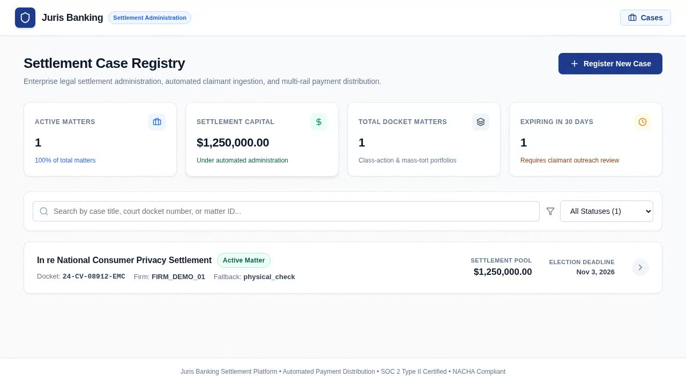
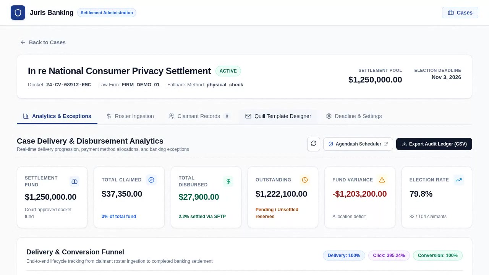
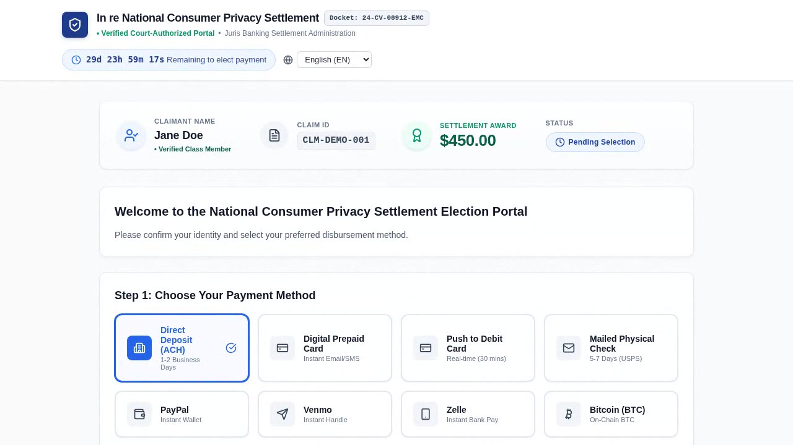
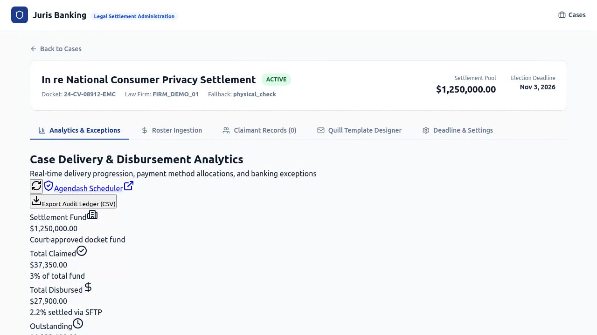

# JurisBanking Platform Training Videos & UX Operational Guide

This document serves as the comprehensive user training manual and media index for the **JurisBanking Automated Payment Distribution System**. It accompanies high-resolution walkthrough video recordings and high-fidelity poster captures covering every critical user experience (UX) flow across the administrative portal, claimant payment selection experience, and real-time backend observability.

---

## 📽️ Video Training Library Overview

All training videos are encoded in universal web-compatible **H.264 (High Profile, YUV420P, FastStart MP4)** at **1280×720 (720p HD)**. They can be embedded directly in web portals or played via standard media players.

| Video | Title | Duration | File Size | Primary Target Audience | Key Capabilities Demonstrated |
| :--- | :--- | :---: | :---: | :--- | :--- |
| **Flow 1** | [Case Setup & Roster Ingestion](#flow-1-case-setup--claimant-roster-batch-ingestion) | `00:20` | `569 KB` | Law Firm Admin, Case Manager | Case registration, settlement fund pool, CSV ingestion, validation preview |
| **Flow 2** | [Quill WYSIWYG & Localization](#flow-2-quill-wysiwyg-template-designer--localization-engine) | `00:10` | `403 KB` | Claims Administrator, Communications | Rich-text template editor, merge tags, multi-lingual switching (EN, ES, ZH, VI) |
| **Flow 3** | [Claimant Portal & 9 Payment Rails](#flow-3-claimant-magic-link-portal--payment-rails-selection) | `00:39` | `1.25 MB` | Claimants, Customer Support | Passwordless magic link, ABA routing check, 9 payment rails, instant receipt |
| **Flow 4** | [Analytics Dashboard & Agendash](#flow-4-real-time-analytics-dashboard-exception-ledger--agendash) | `00:21` | `722 KB` | Managing Partners, Platform Ops | Delivery funnel, disbursement charts, NACHA exception ledger, Agenda jobs |
| **Flow 5** | [Rolling Cadence & Throttling Designer](#flow-5-multi-stage-settlement-cadence-builder--rolling-batch-throttling) | `00:16` | `729 KB` | Claims Administrator, Deliverability Ops | 5-stage deadline-relative timeline, EN/ES/ZH/VI stage templates, sub-batch throttling & 3-layer eligibility preview |
| **Flow 6** | [Live Wave Telemetry & Wave Controls](#flow-6-live-rolling-wave-telemetry-funnel--operational-wave-controls) | `00:31` | `1.27 MB` | Managing Partners, Platform Ops | Real-time wave delivery funnels, sub-batch progress bars, Pause / Resume / Reschedule / Cancel controls & docket audit modal |

---

## Flow 1: Case Setup & Claimant Roster Batch Ingestion

- **Video File**: [`docs/videos/01_case_setup_and_roster_ingestion.mp4`](videos/01_case_setup_and_roster_ingestion.mp4)
- **Poster Snapshot**: [`docs/videos/posters/01_case_setup_and_roster_ingestion.jpg`](videos/posters/01_case_setup_and_roster_ingestion.jpg)



### Objective & Workflow Walkthrough
Demonstrates how a **Law Firm Administrator** logs into the administrative console, creates a new settlement class action matter, establishes the settlement pool parameters, and ingests a multi-record CSV/Excel roster of class members.

### Step-by-Step Training Procedures
1. **Secure Admin Authentication**:
   - Navigate to `/login`.
   - Authenticate with valid firm administrative credentials (`admin@lawfirm.com`).
   - The system establishes an HTTP-only JWT session with Role-Based Access Control (RBAC).
2. **Case Creation**:
   - From the main Case Registry, click **"New Case"**.
   - Input matter parameters:
     - **Case Name**: e.g., *In re National Consumer Privacy Settlement*
     - **Docket Number**: e.g., *1:24-cv-08912-WHA*
     - **Total Settlement Pool**: e.g., *$1,250,000.00*
     - **Disbursement Deadline**: Set the 30-day decision horizon for claimants.
     - **Fallback Payment Rail**: Select default method for non-responsive claimants (e.g., *Physical Check by Mail*).
3. **Claimant Roster Upload & Schema Ingestion**:
   - Navigate to the **"Claimants"** tab within the case.
   - Click **"Import Roster"** and select a formatted CSV or XLSX file (see [`storage/sample_claimants_roster.csv`](../storage/sample_claimants_roster.csv)).
   - The parser inspects required columns: `Claim ID`, `First Name`, `Last Name`, `Email`, `Phone`, `Address`, `Settlement Amount`.
4. **Validation Preview & Ingestion Verification**:
   - The system displays a live validation summary modal with parsed record counts, total allocated funds, and syntax error checks.
   - Click **"Confirm & Ingest Roster"** to commit records to the database.

---

## Flow 2: Quill WYSIWYG Template Designer & Localization Engine

- **Video File**: [`docs/videos/02_quill_wysiwyg_and_localization.mp4`](videos/02_quill_wysiwyg_and_localization.mp4)
- **Poster Snapshot**: [`docs/videos/posters/02_quill_wysiwyg_and_localization.jpg`](videos/posters/02_quill_wysiwyg_and_localization.jpg)



### Objective & Workflow Walkthrough
Demonstrates how claims administrators author court-approved communication copy, insert dynamic merge tags, preview emails across viewports, and customize multi-lingual landing page copy for diverse claimant communities.

### Step-by-Step Training Procedures
1. **Navigating to Template Management**:
   - Within the active case view, select the **"Templates & Communications"** tab.
2. **Quill WYSIWYG Email Authoring**:
   - Use the rich-text toolbar to customize typography, headers, bullet lists, blockquotes, and brand callouts.
   - Insert dynamic merge tags:
     - `{{claimant_first_name}}` / `{{claimant_last_name}}`
     - `{{settlement_amount}}`
     - `{{selection_deadline}}`
     - `{{payment_selection_link}}` (cryptographic magic link button)
   - Server-side sanitization guarantees zero XSS injection vulnerabilities while preserving court-mandated disclosures.
3. **Multi-Lingual Localization Engine**:
   - Switch language selector tabs between:
     - **English (EN)**
     - **Spanish (ES)**: *Notificación de Acuerdo y Selección de Pago*
     - **Chinese Simplified (ZH)**: *和解金分配通知与付款方式选择*
     - **Vietnamese (VI)**: *Thông Báo Giải Quyết và Lựa Chọn Thanh Toán*
   - Verify that landing page introductory notices, FAQ accordions, and claim instructions dynamically update per locale.
4. **Live Device Preview**:
   - Toggle between **Desktop** and **Mobile** preview frames to ensure optimal responsiveness and legibility across all screen dimensions.

---

## Flow 3: Claimant Magic Link Portal & Payment Rails Selection

- **Video File**: [`docs/videos/03_claimant_portal_and_payment_rails.mp4`](videos/03_claimant_portal_and_payment_rails.mp4)
- **Poster Snapshot**: [`docs/videos/posters/03_claimant_portal_and_payment_rails.jpg`](videos/posters/03_claimant_portal_and_payment_rails.jpg)



### Objective & Workflow Walkthrough
Walks through the entire end-user claimant journey: receiving a secure magic link, inspecting their approved settlement award, comparing all 9 supported payout methods, inputting banking or digital wallet credentials with real-time client-side validation, and receiving an official digital submission confirmation receipt.

### Step-by-Step Training Procedures
1. **Passwordless Magic Link Access**:
   - Claimant accesses their unique URL: `https://portal.domain/claim/{paymentSelectionToken}`.
   - The portal validates the 64-character cryptographic token, retrieving claimant identity, docket information, and exact awarded settlement amount ($450.00).
2. **Reviewing Settlement Terms**:
   - Review case overview, disbursement deadline countdown, and claim identification number.
   - Change display language on-the-fly using the top-right locale switcher.
3. **Selecting Payout Rail (9 Comprehensive Rails Supported)**:
   - **Direct Deposit (ACH)**:
     - Real-time **ABA 9-digit Routing Number** check-digit validation.
     - Account number confirmation and Account Type (Checking vs. Savings).
   - **Digital Prepaid Card (Mastercard / Visa)**:
     - Immediate digital issuance via email or SMS with zero bank account requirement.
   - **Push to Debit (Visa Direct / Mastercard Send)**:
     - Instant funds pushed directly to an existing debit card via sanitized 16-digit card number and expiration.
   - **Mailed Physical Check**:
     - Verify or update official postal address with auto-formatted City, State, and ZIP.
   - **PayPal**:
     - Disbursement to verified PayPal email address.
   - **Venmo**:
     - Disbursement to Venmo handle or registered mobile phone number.
   - **Zelle**:
     - Fast clearing via Zelle registered email or phone number.
   - **Bitcoin (BTC On-Chain)**:
     - Native SegWit / Taproot cryptocurrency address validation for decentralized settlement funds.
4. **Electronic Acknowledgment & Digital Receipt**:
   - Provide typed electronic signature certifying penalty of perjury.
   - Click **"Confirm & Submit Payment Preference"**.
   - Review instant on-screen confirmation receipt complete with Submission Reference ID, timestamp, and downloadable PDF receipt summary.

---

## Flow 4: Real-Time Analytics Dashboard, Exception Ledger & Agendash

- **Video File**: [`docs/videos/04_analytics_dashboard_and_agendash.mp4`](videos/04_analytics_dashboard_and_agendash.mp4)
- **Poster Snapshot**: [`docs/videos/posters/04_analytics_dashboard_and_agendash.jpg`](videos/posters/04_analytics_dashboard_and_agendash.jpg)



### Objective & Workflow Walkthrough
Demonstrates operational command and control for law firm partners and case auditors: real-time disbursement funnels, payment rail distribution charts, the automated NACHA/SFTP exception resolution ledger, and background job scheduling via Agendash.

### Step-by-Step Training Procedures
1. **Executive Settlement Analytics**:
   - Select the **"Analytics & Reporting"** tab on the case dashboard.
   - **Delivery Funnel**: Monitor conversion from *Uploaded* ➔ *Dispatched* ➔ *Delivered* ➔ *Portal Visited* ➔ *Method Selected* ➔ *Disbursed*.
   - **Method Breakdown**: Interactive visualization illustrating payment rail distribution (ACH, Push-to-Debit, Digital Cards, Checks, PayPal, Venmo, Zelle, Bitcoin).
   - **Fund Utilization**: Live tracking of Settled Capital ($) vs. In-Flight Disbursements vs. Outstanding Unclaimed Reserves.
2. **Exception Management & NACHA Returns**:
   - Navigate to the **"Exception Ledger"** table.
   - Review flagged records such as:
     - `R01`: Insufficient Funds / Account Invalid
     - `R03`: No Account / Unable to Locate
     - Bounced email dispatches or undeliverable physical check addresses.
   - Trigger one-click resolution actions: *Resend Notification*, *Update Payment Method*, or *Queue for Fallback Check Disbursement*.
3. **Agendash Job Scheduling Orchestration**:
   - Navigate to the authenticated Agenda Dashboard at `/agendash`.
   - Inspect active, queued, and completed distributed jobs:
     - `case:dispatch-notifications`: Throttled email delivery engine.
     - `case:send-deadline-reminders`: 7-day and 48-hour automated claimant alerts.
     - `case:enforce-deadline-fallback`: Automatic deadline reconciliation sweeper.
     - `sftp:generate-and-upload-batch`: Dash Solutions SFTP transmission engine.
     - `sftp:poll-reconciliation-reports`: Inbound status file polling and settlement reconciliation.

---

## Flow 5: Multi-Stage Settlement Cadence Builder & Rolling Batch Throttling

- **Video File**: [`docs/videos/05_rolling_cadence_and_throttling_designer.mp4`](videos/05_rolling_cadence_and_throttling_designer.mp4)
- **Poster Snapshot**: [`docs/videos/posters/05_rolling_cadence_and_throttling_designer.jpg`](videos/posters/05_rolling_cadence_and_throttling_designer.jpg)


### Objective & Workflow Walkthrough
Demonstrates how claims administrators and deliverability engineers configure a **5-stage deadline-relative settlement notification cadence**, customize localized stage templates (`EN`, `ES`, `ZH`, `VI`), tune sub-batch throttling and quiet-hours blackout windows to protect sender reputation, and inspect the **3-Layer Pre-Dispatch Recipient Eligibility Preview** before launching a wave.

### Step-by-Step Training Procedures
1. **Navigating to the Rolling Cadence Console**:
   - Open an active case (`/cases/:id/cadence`) and select the **"Rolling Waves & Cadence"** tab.
   - Ensure the **"Campaign & Throttling Designer"** sub-tab is active.
2. **Configuring the 5-Stage Settlement Cadence Timeline**:
   - Step through the five deterministic stages synchronized relative to the court-ordered `disbursementDeadline`:
     - **Stage 1 (`initial_notice` — `0h` / Immediate Launch)**: Delivers the court-approved award notice and passwordless election magic link to 100% of newly ingested claimants.
     - **Stage 2 (`reminder_14d` — `-336h` / T-14 Days)**: Midway engagement reminder sent exclusively to claimants still in `pending_selection` status.
     - **Stage 3 (`urgent_warning_7d` — `-168h` / T-7 Days)**: Urgent 1-week cutoff alert warning unselected claimants to choose a digital payout rail.
     - **Stage 4 (`final_notice_48h` — `-48h` / T-48 Hours)**: Final warning before default fallback check issuance locks in.
     - **Stage 5 (`post_deadline_fallback` — `+24h` / Post-Deadline)**: Confirmation notice that the digital election window closed and a paper check has been queued.
   - Toggle individual stages on/off and customize per-stage localized templates across **English (`EN`)**, **Español (`ES`)**, **中文 (`ZH`)**, and **Tiếng Việt (`VI`)** using one-click merge tag pills (`{{claimant_first_name}}`, `{{settlement_amount}}`, `{{selection_deadline}}`, `{{payment_selection_link}}`).
3. **Tuning Rolling Batch Throttling & Quiet Hours**:
   - Scroll to the **Rolling Batch Throttling & Dispatch Schedule** card.
   - Choose a one-click pacing preset (**Conservative**: 100 msgs / 15m, **Balanced Standard**: 250 msgs / 15m, or **High Throughput**: 500 msgs / 10m) or fine-tune the **Sub-Batch Chunk Size** and **Inter-Batch Interval Delay** sliders.
   - Enable **Quiet Hours Blackout Window** (e.g., `21:00` to `08:00` in `America/New_York`) so Agenda 6.x automatically defers overnight sub-batches to the next morning's legal send window.
   - Review the **Live Campaign Forecast Panel** to verify total sub-batches, active send duration, and projected completion date relative to the court deadline.
4. **Inspecting the 3-Layer Pre-Dispatch Recipient Eligibility Preview**:
   - Scroll to the **Dynamic Pre-Dispatch Recipient Eligibility Preview** card.
   - Verify the live mathematical breakdown across the 4-segment proportional bar:
     - **Eligible Pending (`8,920`)**: Claimants in `pending_selection` status who will receive the next wave.
     - **Skipped Completed (`2,150`)**: Claimants automatically bypassed because they already submitted their payment preference.
     - **Suppressed Bounced (`1,180`)**: Claimants suppressed due to historical hard bounces or opt-out/suppression registry matches.
     - **Excluded Syntax (`200`)**: Claimants blocked by the Layer-1 RFC 5322 email syntax validator.
   - Click **"Save Configuration"** to persist the cadence and throttling schedule.

---

## Flow 6: Live Rolling Wave Telemetry Funnel & Operational Wave Controls

- **Video File**: [`docs/videos/06_live_wave_telemetry_and_controls.mp4`](videos/06_live_wave_telemetry_and_controls.mp4)
- **Poster Snapshot**: [`docs/videos/posters/06_live_wave_telemetry_and_controls.jpg`](videos/posters/06_live_wave_telemetry_and_controls.jpg)


### Objective & Workflow Walkthrough
Demonstrates real-time wave observability and deterministic operational command-and-control (**Pause**, **Resume**, **Reschedule**, **Cancel**) over in-flight and scheduled settlement notification waves, including WAI-ARIA compliant audit modals with mandatory judicial docket justifications.

### Step-by-Step Training Procedures
1. **Opening the Live Wave Telemetry Console**:
   - Inside `/cases/:id/cadence`, click the **"Live Wave Telemetry & Controls"** sub-tab (`#subtab-telemetry`).
   - Inspect chronological wave cards (`WAVE-APEX-001` Completed, `WAVE-APEX-002` In Progress, `WAVE-APEX-003` Scheduled, `WAVE-APEX-004` Paused).
2. **Monitoring Sub-Batch Progress & Real-Time Delivery Funnels**:
   - Track the high-precision **Sub-Batch Progress Bar** (e.g., `11 of 18 batches (61%)` at `500 msgs/batch every 15m`).
   - Review the 8-counter atomic telemetry funnel on each wave card:
     - `ELIGIBLE` ➔ `QUEUED` ➔ `DISPATCHED` ➔ `SKIPPED (DONE)` ➔ `SUPPRESSED` ➔ `FAILED` + `OPENED (%)` & `CLICKED (%)`.
   - Observe how `SKIPPED (DONE)` climbs automatically as claimants complete their portal elections between waves—eliminating redundant reminder fatigue.
3. **Executing Pause & Resume Controls on an In-Flight Wave**:
   - On an active wave (`WAVE-APEX-002 — 14-Day Payment Preference Reminder`), click **"Pause Wave"**.
   - Enter an operational pause reason in the WAI-ARIA confirmation modal (`#pause-reason-input`) and click **"Confirm Pause"**.
   - The backend atomically marks the wave `paused`, halts pending `SubBatch` records, and cancels queued `wave:dispatch-subbatch` Agenda jobs.
   - Click **"Resume Wave"** and confirm in the modal to re-space remaining sub-batches forward from the current timestamp using `intervalMinutes`.
4. **Rescheduling a Wave with Judicial Docket Justification**:
   - On a scheduled wave (`WAVE-APEX-003 — 7-Day Urgent Deadline Warning`), click **"Reschedule"**.
   - In the accessible **Reschedule Notification Wave** modal (`role="dialog"`, `aria-modal="true"`, focus-trapped), select the updated target dispatch date/time and enter the court-order audit trail reason (e.g., *"Administrative schedule alignment: 48-hour extension granted pursuant to judicial case management order in Docket 24-CV-10492"*).
   - Click **"Confirm Reschedule"** to persist the new schedule and automatically re-index all pending sub-batch execution timestamps.

---

## 🛠️ Automated Video Capture Pipeline

All training videos and poster images in this directory are generated completely deterministically using a headless Chromium browser automation pipeline powered by Playwright and FFmpeg.

### Execution Scripts
The capture pipelines are maintained in:
- [`scripts/capture_training_videos.mjs`](../scripts/capture_training_videos.mjs) (Flows 1–4 core platform walkthroughs)
- [`scripts/capture_rolling_cadence_videos.mjs`](../scripts/capture_rolling_cadence_videos.mjs) (Flows 5–6 rolling cadence, batch throttling, and live wave telemetry walkthroughs)

To re-record or update the training videos from source:
```bash
# Ensure local development prerequisites are running (MongoDB on port 27017)
# Run the core platform video capture pipeline (Flows 1-4):
node scripts/capture_training_videos.mjs

# Run the rolling cadence & wave telemetry video capture pipeline (Flows 5-6):
node scripts/capture_rolling_cadence_videos.mjs
```

### Video Quality & Compression Parameters
The pipeline executes the following two-stage pipeline:
1. **Lossless Capture**: Playwright records the browser context at native 1280×720 viewport resolution at 60 FPS into WebM format.
2. **Universal Transcoding**: FFmpeg transcodes raw WebM streams into H.264 MP4 using optimal compression flags:
   ```bash
   ffmpeg -y -i input.webm \
     -c:v libx264 -preset slow -crf 20 \
     -pix_fmt yuv420p -movflags +faststart \
     output.mp4
   ```
3. **Poster Extraction**: High-clarity JPEG frame grabs are automatically extracted at optimal action keyframes for use in documentation, training slides, and web preview cards.

---

## 📞 Administrative Support & Inquiries

For technical assistance, workflow customization, or API integrations, refer to:
- Technical Documentation & User Guides: [`README.md`](file:///home/robert/projects/juris-banking/README.md)
- Commercial Licensing & Inquiries: [`LICENSE`](file:///home/robert/projects/juris-banking/LICENSE)
- Lead Architect: Robert Baindourov (`rbaindourov@gmail.com`)
