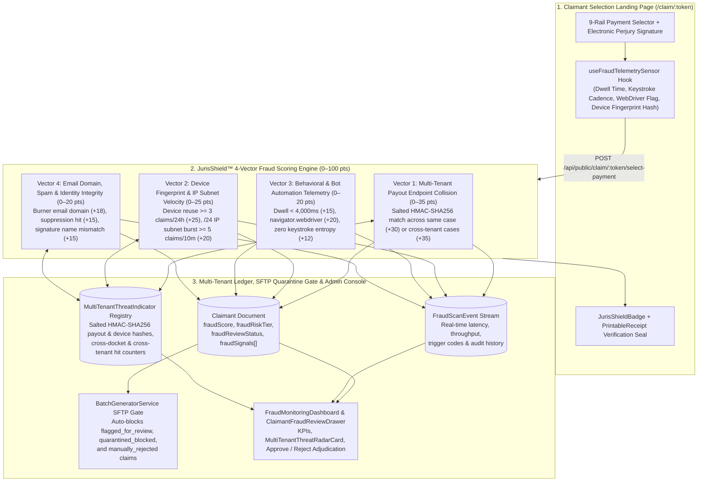
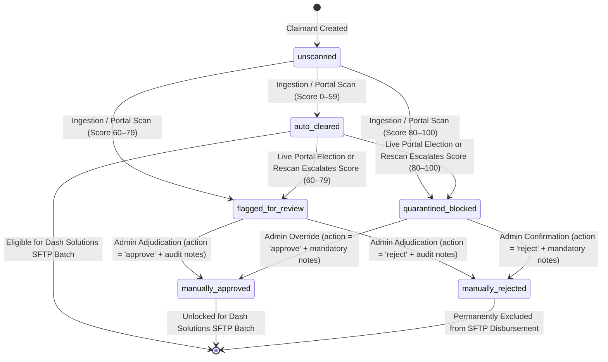
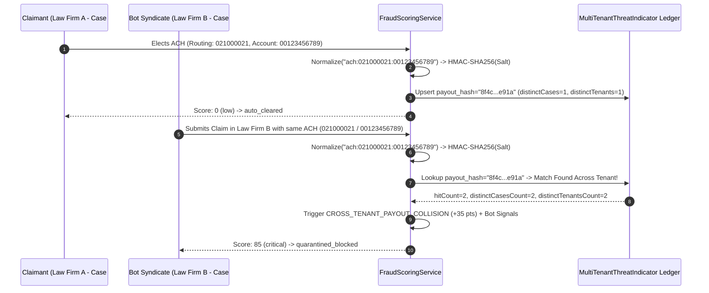
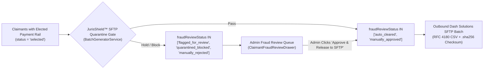

# JurisShield™ Multi-Tenant Fraud Monitoring, Real-Time Scanning Metrics & Claimant Fraud Scoring: Operational UX & Architecture Guide

## 1. Executive Summary & Multi-Tenant Anti-Fraud Value Proposition

### 1.1 The 2025–2026 Class-Action Settlement Fraud Landscape
Modern class-action settlement administration faces an unprecedented surge of industrial-scale automated fraud. Across major consumer, data privacy, antitrust, and mass-tort dockets in 2025–2026, the transition to instant digital payment rails—Direct Deposit (ACH), Push-to-Debit, PayPal, Venmo, Zelle, Virtual Prepaid Cards, and Bitcoin—combined with billions of credentials leaked in third-party data breaches has attracted organized bot farms and synthetic identity rings.

In unguarded settlement portals, automated headless scripts and credential-stuffing syndicates routinely submit hundreds of thousands of synthetic elections—frequently exceeding the legitimate class roster by multiples. When left unchecked, fraudulent claim elections create three existential operational failures:
1. **Pro-Rata Settlement Pool Dilution**: Every fraudulent payout directly reduces the recovery distribution available to verified human class members.
2. **Judicial Final Approval Scrutiny**: Federal and state courts increasingly require settlement administrators and Special Masters to present quantitative claim-validation telemetry, audit logs, and anti-fraud controls before signing Final Distribution Orders.
3. **Single-Tenant Portal Blind Spots**: Traditional single-matter settlement websites inspect claims in total isolation. A legacy single-case portal has zero visibility when the same headless device fingerprint, residential proxy `/24` subnet, disposable email domain, or Venmo/ACH/Bitcoin destination harvests settlement funds across 15 separate law firms and court dockets simultaneously.

---

### 1.2 Two Core Market Differentiators for JurisBanking (`JurisShield™`)
**JurisShield™** is JurisBanking's native, real-time multi-tenant fraud prevention, behavioral telemetry, and quantitative claimant scoring engine. It establishes two decisive competitive advantages for law firms, claims administrators, and court-appointed Special Masters:

1. **Multi-Tenant Cross-Domain & Cross-Matter Threat Visibility**:
   - Because JurisBanking operates as a unified multi-tenant settlement distribution engine across law firms, court dockets, and registered internet domains, a threat indicator observed on *any* tenant or case immediately enriches the **Global Multi-Tenant Threat Intelligence Registry** (`MultiTenantThreatIndicator`).
   - Disposable burner email domains, botnet ASN/IP velocity clusters, headless browser fingerprints, and shared payout endpoints (e.g., a single ACH account, debit card token, PayPal address, Venmo handle, Zelle phone/email, physical check address, or Bitcoin wallet attached to multiple distinct claimant identities across separate law firms) are correlated in sub-10ms real time without ever exposing raw cross-tenant Personally Identifiable Information (PII).
2. **Claimant Payment-Selection Landing Page (`/claim/:token`) as an Active Anti-Fraud Sensor**:
   - JurisBanking transforms the public 9-rail payment selection landing page (`ClaimantPortalPage`) from a passive web form into an active, zero-friction **Behavioral & Device Security Shield**.
   - As a claimant selects a payment rail and signs the electronic perjury declaration, the `useFraudTelemetrySensor` hook passively captures interaction entropy—session dwell time, pointer/touch events, signature keystroke cadence, hardware/canvas device fingerprint hash, and WebDriver automation flags—and pairs those signals with backend cross-tenant collision and velocity checks.
   - Every claimant receives a deterministic **Fraud Score (`0–100`)**, **Risk Tier (`low`, `medium`, `high`, `critical`)**, and **Explainable Signal Breakdown**, while the **Dash Solutions SFTP Quarantine Gate** automatically holds high-risk and critical claims before a single dollar can leave the settlement escrow account.

---

### 1.3 End-to-End Multi-Tenant Fraud Defense Architecture



---

## 2. JurisShield™ 4-Vector Quantitative Claimant Fraud Scoring Model (`0–100`)

Every claimant record is evaluated both during **Two-Phase Roster Ingestion Pre-Scan** (`ingestion_prescan`) and synchronously upon **Live Portal Payment Election** (`portal_submission`), as well as during on-demand **Case Rescans** (`manual_rescan`) and **Pre-SFTP Gate Checks** (`pre_sftp_gate`).

The `FraudScoringService` computes a composite score bounded between `0` and `100` by summing contributions across four orthogonal risk vectors, each capped at its maximum vector weight.

### 2.1 Vector Breakdown & Signal Catalogue

| Vector # | Category Key | Vector Weight Cap | Signal Code | Score Contribution | Trigger Condition & Heuristic Definition |
| :---: | :--- | :---: | :--- | :---: | :--- |
| **1** | `payout_collision` | **`0–35 pts`** | `CROSS_TENANT_PAYOUT_COLLISION` | `+35 pts` | Salted HMAC-SHA256 `payoutEndpointHash` matches one or more claimants in a **different law firm tenant or separate court docket**. |
| **1** | `payout_collision` | **`0–35 pts`** | `SAME_CASE_PAYOUT_COLLISION` | `+30 pts` | Salted HMAC-SHA256 `payoutEndpointHash` is shared by multiple distinct `claimId` records within the **same settlement case**. |
| **2** | `velocity_device` | **`0–25 pts`** | `DEVICE_FINGERPRINT_VELOCITY` | `+25 pts` | Identical `deviceFingerprintHash` used to submit $\ge 3$ claimant elections within a rolling 24-hour window across any case. |
| **2** | `velocity_device` | **`0–25 pts`** | `IP_SUBNET_BURST` | `+20 pts` | Identical IPv4 `/24` subnet (or IPv6 `/48` prefix) submitting $\ge 5$ claims within a 10-minute sliding window. |
| **2** | `velocity_device` | **`0–25 pts`** | `DATACENTER_OR_TIMEZONE_ANOMALY` | `+10 pts` | Known hosting/VPN/proxy ASN or mismatch between browser `timezoneOffset` and IP geolocation region. |
| **3** | `behavioral_bot` | **`0–20 pts`** | `HEADLESS_WEBDRIVER_DETECTED` | `+20 pts` | Client telemetry reports `webdriverDetected === true` (`navigator.webdriver`, Puppeteer/Playwright/Selenium automation flags, or missing renderer entropy). |
| **3** | `behavioral_bot` | **`0–20 pts`** | `SUBHUMAN_DWELL_SPEED` | `+15 pts` | Portal session dwell time from page load to payment election submission is $< 4,000\text{ ms}$ (`dwellTimeMs < 4000`). |
| **3** | `behavioral_bot` | **`0–20 pts`** | `ZERO_INTERACTION_CADENCE` | `+12 pts` | Electronic signature submitted via programmatic DOM value injection with zero human keystroke cadence (`keystrokeCount < 2`) or pointer entropy (`interactionCount < 2`). |
| **4** | `identity_domain` | **`0–20 pts`** | `DISPOSABLE_EMAIL_DOMAIN` | `+18 pts` | Claimant email belongs to a curated disposable/burner domain (`mailinator.com`, `guerrillamail.com`, `10minutemail.com`, `tempmail.com`, `yopmail.com`, `trashmail.com`, `sharklasers.com`, etc.). |
| **4** | `identity_domain` | **`0–20 pts`** | `GLOBAL_SUPPRESSION_OR_BOUNCE_HIT` | `+15 pts` | Claimant email or domain appears on the multi-tenant hard-bounce/spam-trap suppression registry (`SuppressionList` / `MultiTenantThreatIndicator`). |
| **4** | `identity_domain` | **`0–20 pts`** | `SIGNATURE_NAME_MISMATCH` | `+15 pts` | Normalized token/Levenshtein similarity between typed perjury `signatureText` and roster `firstName + lastName` falls below the verification threshold. |

#### Composite Score Formula
For any evaluated claimant $c$, let $S_k(c)$ denote the sum of triggered signal contributions in vector $k \in \{1, 2, 3, 4\}$ and $W_k$ denote the vector cap ($W_1 = 35, W_2 = 25, W_3 = 20, W_4 = 20$):

$$\text{FraudScore}(c) = \min\left(100, \sum_{k=1}^{4} \min\left(W_k, S_k(c)\right)\right)$$

---

### 2.2 Deterministic Risk Tiers & Review Status Transitions

| Fraud Score Range | Risk Tier (`fraudRiskTier`) | UI Badge Color | Default `fraudReviewStatus` | Automated SFTP Disbursement Gate Behavior |
| :---: | :---: | :---: | :---: | :--- |
| **`0 – 29`** | `low` | Emerald (`#10b981`) | `auto_cleared` | **Cleared**: Automatically eligible for inclusion in outbound Dash Solutions SFTP payment batches. |
| **`30 – 59`** | `medium` | Amber (`#f59e0b`) | `auto_cleared` | **Monitored & Cleared**: Eligible for SFTP batching by default; highlighted with an Amber watch pill in the Admin Console for spot auditing. |
| **`60 – 79`** | `high` | Orange (`#f97316`) | `flagged_for_review` | **Held from SFTP Batching**: Placed in the Fraud Review Queue. Requires a Case Manager or Law Firm Admin to review signal evidence and click **Approve** or **Reject**. |
| **`80 – 100`** | `critical` | Crimson (`#ef4444`) | `quarantined_blocked` | **Quarantined & Blocked**: Immediately blocked from SFTP disbursement. Increments global `MultiTenantThreatIndicator` hit counters; requires explicit administrative override with mandatory audit justification to release. |

---

### 2.3 Claimant Fraud Review Lifecycle State Machine



---

## 3. Privacy-Preserving Cross-Tenant Threat Intelligence

### 3.1 Zero-PII Cross-Tenant Correlation via Salted HMAC-SHA256
In a multi-tenant legal SaaS environment, law firms operate under strict attorney-client privilege, protective orders, and state/federal privacy regulations (CCPA/CPRA, GLBA, HIPAA). Law Firm A cannot view raw bank account numbers, Venmo handles, or mailing addresses belonging to claimants represented by Law Firm B.

JurisShield™ solves cross-tenant fraud correlation without ever exposing raw PII across tenant boundaries by computing deterministic, salted **HMAC-SHA256 cryptographic digests** (`payoutEndpointHash` and `deviceFingerprintHash`) using a platform-level secret salt (`FRAUD_HMAC_SECRET`).



---

### 3.2 Canonical Payout Endpoint Normalization across All 9 Rails
Before computing `payoutEndpointHash`, `FraudScoringService.computePayoutEndpointHash()` canonically normalizes the target destination so cosmetic formatting variations (spaces, hyphens, uppercase/lowercase, `+1` country codes, street abbreviations) produce the exact same cryptographic hash:

| Payment Rail | Canonical Normalization Rule Prior to HMAC-SHA256 | Example Raw Input $\to$ Normalized String |
| :--- | :--- | :--- |
| **1. Direct Deposit (`ach`)** | Strip non-digits from routing and account numbers; prefix with `ach:`. | `Routing: 021000021, Acct: 1234-5678-9` $\to$ `ach:021000021:123456789` |
| **2. Push to Debit (`debit_card`)** | Strip spaces/dashes from card token or PAN digits; prefix with `debit_card:`. | `4111 1111 1111 1234` $\to$ `debit_card:4111111111111234` |
| **3. PayPal (`paypal`)** | Lowercase, trim whitespace, normalize Gmail dot/plus aliases if email, or strip non-digits if phone; prefix with `paypal:`. | `Fraud.Ring+01@Gmail.com ` $\to$ `paypal:fraud.ring+01@gmail.com` |
| **4. Venmo (`venmo`)** | Strip leading `@`, lowercase handle or normalize 10-digit US phone; prefix with `venmo:`. | `@Syndicate-Wallet_99` $\to$ `venmo:syndicate-wallet_99` |
| **5. Zelle (`zelle`)** | Lowercase email or normalize 10-digit US phone (stripping `+1`, parentheses, dashes); prefix with `zelle:`. | `+1 (415) 555-0199` $\to$ `zelle:4155550199` |
| **6. Bitcoin (`bitcoin`)** | Trim whitespace; preserve case for Base58Check (`1...`/`3...`) or lowercase Bech32/Bech32m (`bc1...`); prefix with `bitcoin:`. | `BC1QXY2KGJGJRSQZ...` $\to$ `bitcoin:bc1qxy2kgjgjrsqz...` |
| **7. Physical Check (`physical_check`)** | Uppercase and collapse whitespace across `addressLine1 + city + state + zip5`; standardize common suffixes (`STREET`$\to$`ST`, `AVENUE`$\to$`AVE`, `APARTMENT`$\to$`APT`); prefix with `check:`. | `123 Main Street, Apt 4B, Austin, TX 78701-1234` $\to$ `check:123 MAIN ST APT 4B|AUSTIN|TX|78701` |
| **8. Digital Virtual Card (`virtual_card`)** | Normalized recipient delivery email (`virtual_card:<lowercase_email>`). | `User@Domain.org` $\to$ `virtual_card:user@domain.org` |

---

### 3.3 `MultiTenantThreatIndicator` & `FraudScanEvent` Schemas
The backend persists threat intelligence in two dedicated Mongoose collections with sub-10ms compound indexes:

1. **`MultiTenantThreatIndicator` (`server/src/models/MultiTenantThreatIndicator.ts`)**:
   - `indicatorType`: `'payout_hash' | 'device_fingerprint' | 'ip_subnet' | 'email_domain'`
   - `indicatorValue`: Salted HMAC-SHA256 hex digest, `/24` CIDR subnet, or lowercase domain string.
   - `hitCount`: Total number of claim submissions matching this indicator across the platform.
   - `distinctCasesCount` & `distinctTenantsCount`: Number of unique cases (`caseIds[]`) and law firm tenants (`lawFirmIds[]`) impacted.
   - `severity`: `'low' | 'medium' | 'high' | 'critical'`
   - `blocked`: Boolean flag indicating active platform-wide block enforcement.
2. **`FraudScanEvent` (`server/src/models/FraudScanEvent.ts`)**:
   - Immutable time-series audit record created for every scan (`scanType: 'portal_submission' | 'ingestion_prescan' | 'manual_rescan' | 'pre_sftp_gate'`).
   - Captures `scanDurationMs`, `fraudScore`, `riskTier`, `reviewStatusAssigned`, `triggeredSignals[]`, `settlementAmountAtRisk`, `ipSubnet`, `emailDomain`, `deviceFingerprintHash`, and `payoutEndpointHash`.

---

## 4. Claimant Payment-Selection Landing Page (`/claim/:token`) Active Sensor

### 4.1 Passive Client-Side Behavioral Telemetry (`useFraudTelemetrySensor.ts`)
When a claimant opens their passwordless magic link (`/claim/:token`), `ClaimantPortalPage.tsx` initializes the `useFraudTelemetrySensor()` React hook (`client/src/portal/hooks/useFraudTelemetrySensor.ts`).

The sensor operates with **zero user friction**—requiring no CAPTCHAs, no invasive browser permissions, and zero impact on legitimate claimant conversion rates—while continuously recording:
- **Session Dwell Time (`dwellTimeMs`)**: High-precision elapsed time from portal mount (`performance.now()`) to payment submission. Genuine human claimants typically take 20–90 seconds to read their settlement entitlement, choose one of the 9 payment rails, enter their routing/account or handle, and type their legal name. Headless bot scripts submit in `< 4,000 ms`.
- **Pointer & Touch Entropy (`interactionCount`)**: Counts organic pointer movements, clicks, focus shifts, and touch events across the payment rail cards.
- **Signature Keystroke Cadence (`keystrokeCount`)**: Tracks individual keyboard events while typing the electronic perjury declaration (`signatureText`). Automated scripts that set `.value` directly via DOM injection register `0` keystrokes.
- **Automation & WebDriver Detection (`webdriverDetected`)**: Inspects `navigator.webdriver`, headless user-agent tokens (`HeadlessChrome`, `PhantomJS`), and automation globals (`__playwright`, `__puppeteer_evaluation_script__`, `_selenium`).
- **Deterministic Device Fingerprint (`deviceFingerprint`)**: Generates a privacy-safe client hardware/environment hash combining screen resolution, color depth, hardware concurrency, browser locale, timezone offset, and platform signature.

When the claimant clicks **Confirm & Submit Payment Selection**, `ClaimantPortalPage` packages the `telemetry` payload inside `POST /api/public/claim/:token/select-payment`:

```json
{
  "paymentMethod": "venmo",
  "paymentDetails": {
    "venmoHandle": "@john-doe-claimant"
  },
  "signatureText": "John Doe",
  "telemetry": {
    "dwellTimeMs": 38420,
    "interactionCount": 27,
    "keystrokeCount": 8,
    "webdriverDetected": false,
    "deviceFingerprint": "dfp_94a8c21e7b03f5d1a6209c84e1b7f302",
    "timezoneOffset": 420,
    "screenResolution": "1920x1080"
  }
}
```

---

### 4.2 Visual Trust Assurance (`JurisShieldBadge.tsx` & `PrintableReceipt.tsx`)
To reinforce claimant confidence while deterring manual fraudsters:
- **Portal Security Banner (`JurisShieldBadge.tsx`)**: Renders the **"Protected by JurisShield™ Real-Time Fraud & Identity Verification"** banner directly on the payment selection portal, displaying active session protection status, 256-bit HMAC endpoint verification, and court-audited anti-fraud compliance.
- **Cryptographic Receipt Seal (`PrintableReceipt.tsx`)**: Upon completion, the backend returns a `securityVerification` receipt object containing a unique `scanId`, ISO-8601 `verifiedAt` timestamp, and `shieldStatus` (`verified_clean` or `pending_audit_verification`), which is embedded directly into the claimant's printable confirmation receipt.

---

## 5. Automated SFTP Disbursement Quarantine Gate & Admin Review Workflow

### 5.1 Pre-Disbursement Quarantine Gate (`BatchGeneratorService`)
The ultimate safeguard in JurisShield™ is the **Dash Solutions SFTP Quarantine Gate** enforced inside `BatchGeneratorService.generateOutboundBatch()` (`server/src/services/batchGenerator.service.ts`).

When an Agenda background job or an administrator triggers outbound SFTP batch generation for a settlement case:
1. `BatchGeneratorService` queries claimants whose payment election is `selected` (or defaulted via court fallback).
2. **Quarantine Filter Enforcement**: Any claimant whose `fraudReviewStatus` is in `['flagged_for_review', 'quarantined_blocked', 'manually_rejected']` is **strictly excluded** from the outbound RFC 4180 CSV payment batch.
3. Only claimants with `fraudReviewStatus` in `['auto_cleared', 'manually_approved']` (or legacy `'unscanned'` records with `fraudScore < 60`) are drawn into the SFTP batch and transitioned to `status: 'batched'`.
4. Held claimants remain safely in escrow until a Case Manager or Law Firm Admin adjudicates them in the Admin Console.



---

### 5.2 Admin Console UX (`FraudMonitoringDashboard`, `MultiTenantThreatRadarCard`, `ClaimantFraudReviewDrawer`)
Inside the administrative React application (`client/src/pages/CaseDetail.tsx`), authorized users (`super_admin`, `platform_admin`, `law_firm_admin`, `case_manager`, `auditor`) can open the **"Fraud Shield & Scoring"** tab (`FraudMonitoringDashboard.tsx`) or view color-coded Fraud Score pills directly in the **Claimants** roster table:

1. **Real-Time Scanning Metrics KPI Bar**:
   - **Settlement Pool Protected ($)**: Total dollar value of claims currently intercepted in `flagged_for_review`, `quarantined_blocked`, or `manually_rejected` states.
   - **Claims Scanned & Coverage (%)**: Total claimants evaluated vs. total case roster, with a one-click **Run Full Case Rescan** action.
   - **Scan Throughput & Latency**: Average scan duration in milliseconds (`avgLatencyMs`) and recent scan velocity (`scansPerMinute`).
   - **Quarantined / Flagged Queue Counter**: Immediate count of high-risk (`60–79`) and critical (`80–100`) claims awaiting human review.
2. **Multi-Tenant Internet Spam & Fraud Visibility Radar (`MultiTenantThreatRadarCard.tsx`)**:
   - Displays cross-domain and cross-docket threat intelligence aggregated from `GET /api/fraud/network-intelligence`, including:
     - Active disposable/spam email domains blocked across the network.
     - Cross-matter duplicate payout endpoints intercepted (e.g., identical ACH, Venmo, or BTC accounts seen across multiple cases/firms).
     - High-velocity IP `/24` subnets and shared device fingerprints.
     - Total network-wide settlement funds protected.
3. **Interactive Claimant Fraud Review Drawer (`ClaimantFraudReviewDrawer.tsx`)**:
   - Clicking **Inspect / Adjudicate** on any claimant opens the evidence drawer showing:
     - The claimant's composite `fraudScore` (`0–100`), `fraudRiskTier`, and current `fraudReviewStatus`.
     - Every triggered signal in `fraudSignals[]` with its exact point contribution (`+35 pts`, `+20 pts`, etc.), category badge, and timestamp.
     - Portal behavioral telemetry (`dwellTimeMs`, `keystrokeCount`, `interactionCount`, `webdriverDetected`, `screenResolution`, `deviceFingerprintHash`, `payoutEndpointHash`).
     - **Adjudication Controls**: Authorized administrators (`law_firm_admin`, `case_manager`, `platform_admin`, `super_admin`) enter mandatory review notes and click either:
       - **Approve & Release to SFTP** (`action: 'approve'` $\to$ sets `fraudReviewStatus = 'manually_approved'`, unlocking the claim for the next Dash Solutions SFTP batch), or
       - **Quarantine & Reject Claim** (`action: 'reject'` $\to$ sets `fraudReviewStatus = 'manually_rejected'`, permanently barring disbursement).

---

## 6. REST API Reference & Verification Commands

All administrative fraud endpoints require a valid Bearer JWT (`Authorization: Bearer <token>`) or `HttpOnly` session cookie and enforce role-based access control (`super_admin`, `platform_admin`, `law_firm_admin`, `case_manager`, `auditor`). Mutating endpoints (`review` and `rescan`) are restricted to write-capable roles (`super_admin`, `platform_admin`, `law_firm_admin`, `case_manager`).

### 6.1 Endpoint Summary Table

| Method | Endpoint Path | Auth / RBAC Roles | Purpose |
| :---: | :--- | :--- | :--- |
| `POST` | `/api/public/claim/:token/select-payment` | Public (64-hex signed token) | Submits claimant payment selection + `telemetry` payload; runs synchronous 4-vector fraud scoring and returns `securityVerification` receipt seal. |
| `GET` | `/api/cases/:caseId/fraud/metrics` | Admin / Case Manager / Auditor | Returns case-level scanning KPIs, risk tier distribution, settlement dollars protected, top signal frequencies, and recent `FraudScanEvent` feed. |
| `GET` | `/api/cases/:caseId/fraud/claimants` | Admin / Case Manager / Auditor | Returns paginated, filterable claimant fraud queue (`riskTier`, `fraudReviewStatus`, `signalCode`, `minScore`, `page`, `limit`). |
| `POST` | `/api/cases/:caseId/fraud/claimants/:claimantId/review` | Admin / Case Manager (Write) | Adjudicates a flagged/quarantined claimant (`action: 'approve' \| 'reject'`, `notes`), updating `fraudReviewStatus` and recording an audit log entry. |
| `POST` | `/api/cases/:caseId/fraud/rescan` | Admin / Case Manager (Write) | Re-evaluates all claimants in the case against current multi-tenant threat indicators and velocity windows. |
| `GET` | `/api/fraud/network-intelligence` | Admin / Case Manager / Auditor | Returns platform-wide multi-tenant spam, bot, and cross-matter payout collision telemetry across all cases and law firms. |

---

### 6.2 Detailed Endpoint Contracts & `curl` Verification Examples

#### 1. Fetch Case Real-Time Fraud Metrics
```bash
curl -s -X GET "http://localhost:5000/api/cases/<CASE_ID>/fraud/metrics" \
  -H "Authorization: Bearer <JWT_TOKEN>" | jq .
```
**Sample `200 OK` Response:**
```json
{
  "caseId": "67103f9a8c12e40012ab3401",
  "totalClaimants": 1250,
  "totalScanned": 1250,
  "scanCoveragePercent": 100,
  "avgScanLatencyMs": 4.2,
  "scansPerMinute": 180,
  "settlementPoolProtected": 48750.00,
  "riskTierDistribution": {
    "low": 1142,
    "medium": 64,
    "high": 29,
    "critical": 15
  },
  "reviewStatusDistribution": {
    "unscanned": 0,
    "auto_cleared": 1206,
    "flagged_for_review": 29,
    "quarantined_blocked": 15,
    "manually_approved": 0,
    "manually_rejected": 0
  },
  "topTriggeredSignals": [
    { "code": "CROSS_TENANT_PAYOUT_COLLISION", "count": 18 },
    { "code": "HEADLESS_WEBDRIVER_DETECTED", "count": 15 },
    { "code": "DISPOSABLE_EMAIL_DOMAIN", "count": 14 }
  ]
}
```

#### 2. Query Paginated Claimant Fraud Review Queue
```bash
curl -s -X GET "http://localhost:5000/api/cases/<CASE_ID>/fraud/claimants?riskTier=critical&fraudReviewStatus=quarantined_blocked&minScore=80&page=1&limit=20" \
  -H "Authorization: Bearer <JWT_TOKEN>" | jq .
```

#### 3. Adjudicate a Flagged or Quarantined Claimant (`approve` / `reject`)
```bash
curl -s -X POST "http://localhost:5000/api/cases/<CASE_ID>/fraud/claimants/<CLAIMANT_ID>/review" \
  -H "Authorization: Bearer <JWT_TOKEN>" \
  -H "Content-Type: application/json" \
  -d '{
    "action": "approve",
    "notes": "Verified joint family checking account via notarized claimant affidavit; cleared for SFTP batching."
  }' | jq .
```

#### 4. Trigger Full Case Fraud Rescan
```bash
curl -s -X POST "http://localhost:5000/api/cases/<CASE_ID>/fraud/rescan" \
  -H "Authorization: Bearer <JWT_TOKEN>" | jq .
```

#### 5. Fetch Multi-Tenant Network Threat Intelligence
```bash
curl -s -X GET "http://localhost:5000/api/fraud/network-intelligence" \
  -H "Authorization: Bearer <JWT_TOKEN>" | jq .
```
**Sample `200 OK` Response:**
```json
{
  "totalNetworkScans": 14820,
  "totalProtectedFundsAcrossNetwork": 312450.00,
  "crossTenantCollisionsDetected": 42,
  "disposableDomainsBlocked": 19,
  "highVelocitySubnetsBlocked": 7,
  "recentIndicators": [
    {
      "indicatorType": "payout_hash",
      "indicatorValue": "8f4c902a1d77b3e0...e91a",
      "hitCount": 14,
      "distinctCasesCount": 3,
      "distinctTenantsCount": 2,
      "severity": "critical",
      "blocked": true
    }
  ]
}
```

---

### 6.3 Automated Test Suite Verification Commands

To run the complete unit, integration, and adversarial negative-control test suites for JurisShield™:

```bash
# 1. Run Fraud Data Model & Zod Validation Unit Tests
cd server && npx vitest run tests/unit/fraudModels.test.ts

# 2. Run 4-Vector Fraud Scoring Engine Unit & Integration Tests
cd server && npx vitest run tests/unit/fraudScoring.service.test.ts tests/integration/fraudMonitoring.test.ts

# 3. Run Adversarial Bot-Farm & Cross-Tenant Negative Control Suite
cd server && npx vitest run tests/adversarial/fraudScoringAdversarial.test.ts

# 4. Build Server TypeScript & Client Vite Production Bundles
npm run build
```
