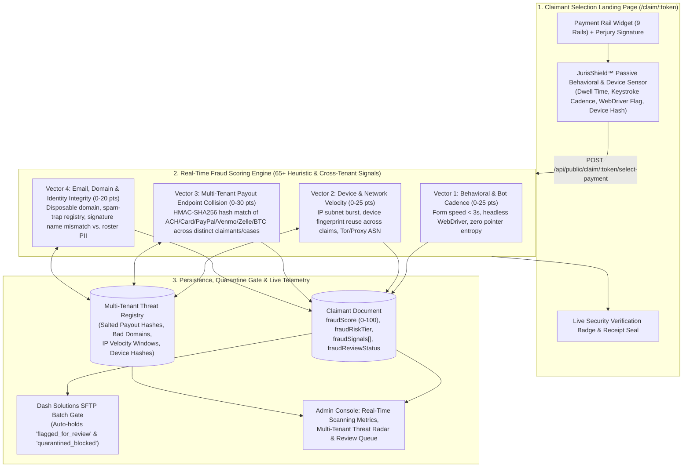
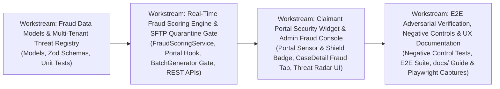

# JurisBanking Multi-Tenant Fraud Monitoring, Real-Time Scanning Metrics & Claimant Fraud Scoring Plan (`JurisShield™`)

- **Date**: 2026-10-16
- **Target Repository**: `/home/robert/projects/juris-banking-settlement-payment-automation`
- **Conversation ID**: `3065669c-b6ab-437e-9da7-6b0f0f2decff`
- **Agent**: `agents@webdesigner`
- **Status**: Implemented, Tested, Committed & Pushed (`aba2e0d` — 50/50 Fraud & Regression Tests Passing, 0 Build Errors)

---

## 1. Executive Summary & Industry Research Synthesis

### 1.1 The Class-Action Settlement Fraud Crisis (2025–2026 Industry Landscape)
Modern class-action settlement administration faces an unprecedented wave of automated fraud. As documented across recent legal technology disclosures (A.B. Data's *Signal™*, Angeion Group's *AngeionAffirm*, Kroll, EisnerAmper, and *ClaimScore*), the shift toward frictionless digital payouts (ACH, Venmo, PayPal, Zelle, Virtual Cards, Bitcoin) combined with credentials leaked in corporate data breaches has attracted industrial-scale bot farms and synthetic identity syndicates.

In major consumer and privacy dockets, automated scripts and coordinated fraud rings have generated hundreds of thousands to millions of synthetic claims—sometimes exceeding the legitimate class size by multiples. Unchecked fraudulent submissions:
1. **Dilute Pro-Rata Settlement Pools**: Stealing recovery funds directly from verified human class members.
2. **Compromise Judicial Final Approval**: Courts increasingly scrutinize administrator claim-validation methodologies before signing distribution orders.
3. **Exploit Single-Case Blind Spots**: Legacy single-tenant portals evaluate claims in isolation, failing to notice when the same device fingerprint, proxy subnet, or Venmo/ACH/Bitcoin destination harvests payouts across 15 different law firms and settlement dockets simultaneously.

### 1.2 Two Core Market Differentiators for JurisBanking
Bringing native **Multi-Tenant Fraud Monitoring (`JurisShield™`)** into JurisBanking establishes two decisive competitive advantages:

1. **Multi-Tenant Cross-Domain & Cross-Docket Threat Visibility**:
   - Because JurisBanking operates as a multi-tenant settlement engine across law firms, dockets, and registered internet domains, a threat detected on *any* tenant or domain immediately enriches the **Global Multi-Tenant Threat Intelligence Registry**.
   - Spam traps, disposable email domains, botnet ASN/IP clusters, headless browser fingerprints, and compromised payout accounts (e.g., a single ACH account, PayPal email, Venmo handle, Zelle phone, or BTC address attached to multiple distinct claimant identities across different cases) are correlated in real time across the entire platform without exposing raw cross-tenant PII (using salted HMAC-SHA256 identity and payout hashes).
2. **Payment-Selection Landing Page (`ClaimantPortalPage`) as an Active Anti-Fraud Shield**:
   - One of the strongest selling points of JurisBanking's interactive 9-rail payment selection landing page (`/claim/:token`) is live, zero-friction **Behavioral & Device Fraud Monitoring**.
   - As a claimant interacts with the payment selection widget, lightweight client-side telemetry captures human interaction signals (dwell time, keystroke/pointer cadence, headless browser/WebDriver anomalies, Canvas/WebGL hardware fingerprint hash, and timezone/locale consistency) and pairs them with server-side velocity, identity, and payout-endpoint cross-checks.
   - Every claimant submission receives an immediate, quantitative **Fraud Score (`0–100`)**, **Risk Tier (`low`, `medium`, `high`, `critical`)**, and **Explainable Signal Vector Breakdown**, while automatically quarantining high-risk claims before they ever enter a Dash Solutions SFTP banking batch.

---

## 2. System Architecture & Multi-Layer Scoring Engine



### 2.1 Quantitative Claimant Fraud Score (`0` to `100`) & Risk Tiers

Every claimant submission (both at roster ingestion pre-scan and upon live portal payment election) is evaluated across **4 weighted risk categories** totaling `0–100` points:

| Risk Category | Weight Cap | Key Evaluated Signals & Heuristics |
| :--- | :---: | :--- |
| **1. Multi-Tenant Payout Endpoint Collision** | `0–35 pts` | Salted HMAC-SHA256 hash of normalized payout target (ACH routing+account, Debit card token, PayPal email, Venmo handle, Zelle recipient, Physical Check address, or Bitcoin address) matched against other claimants in the **same case** (`+30 pts`) or **across other tenant cases** (`+35 pts`). |
| **2. Device Fingerprint & IP Velocity** | `0–25 pts` | Device fingerprint hash submitted $\ge 3$ claims within 24h (`+25 pts`); IP address or `/24` subnet burst submitting $\ge 5$ claims in 10 minutes (`+20 pts`); datacenter/known botnet ASN or timezone mismatch vs. IP geo (`+10 pts`). |
| **3. Behavioral & Bot Automation Telemetry** | `0–20 pts` | Portal session dwell time from page load to submission $< 4,000\text{ ms}$ (`+15 pts`); `navigator.webdriver === true` or missing browser renderer entropy (`+20 pts`); zero human keystroke/pointer cadence events on typed signature (`+12 pts`). |
| **4. Email Domain, Spam & Identity Integrity** | `0–20 pts` | Disposable/burner email provider domain (`mailinator`, `tempmail`, `guerrillamail`, etc., `+18 pts`); global multi-tenant suppression/bounce hit (`+15 pts`); Levenshtein/token mismatch between typed electronic perjury signature and claimant roster `firstName + lastName` (`+15 pts`). |

#### Deterministic Risk Tier & Automated Gate Actions

| Fraud Score Range | Risk Tier (`fraudRiskTier`) | Default Review Status (`fraudReviewStatus`) | Automated SFTP Disbursement Gate Behavior |
| :---: | :---: | :---: | :--- |
| **`0 – 29`** | `low` | `auto_cleared` | Eligible for immediate inclusion in outbound Dash Solutions SFTP batches. |
| **`30 – 59`** | `medium` | `auto_cleared` (with audit watch flag) | Eligible for SFTP batching by default (unless case strict-mode threshold is lowered), highlighted in telemetry. |
| **`60 – 79`** | `high` | `flagged_for_review` | **Held from SFTP batching**. Routed to Case Manager Fraud Review Queue for manual approval or rejection. |
| **`80 – 100`** | `critical` | `quarantined_blocked` | **Blocked from SFTP batching**. Multi-tenant threat registry updated; requires explicit Law Firm Admin override with mandatory audit justification. |

---

## 3. Data Model & API Interface Contracts

### 3.1 `Claimant` Model Extensions (`server/src/models/Claimant.ts`)
Add structured fraud scoring and telemetry fields directly to `IClaimant` and `ClaimantSchema`:
- `fraudScore: number` (`0–100`, default `0`, indexed)
- `fraudRiskTier: 'low' | 'medium' | 'high' | 'critical'` (default `'low'`, indexed)
- `fraudReviewStatus: 'unscanned' | 'auto_cleared' | 'flagged_for_review' | 'quarantined_blocked' | 'manually_approved' | 'manually_rejected'` (default `'unscanned'`, indexed)
- `fraudSignals: Array<{ code: string; category: 'payout_collision' | 'velocity_device' | 'behavioral_bot' | 'identity_domain'; severity: 'low' | 'medium' | 'high' | 'critical'; scoreContribution: number; description: string; detectedAt: Date }>`
- `fraudScannedAt?: Date`
- `fraudReviewedBy?: string`
- `fraudReviewedAt?: Date`
- `fraudReviewNotes?: string`
- `deviceFingerprintHash?: string` (indexed sparse)
- `payoutEndpointHash?: string` (HMAC-SHA256 hash of normalized payment target for privacy-preserving cross-tenant collision detection, indexed sparse)
- `portalSessionMetrics?: { dwellTimeMs?: number; interactionCount?: number; keystrokeCount?: number; webdriverDetected?: boolean; timezoneOffset?: number; screenResolution?: string }`

### 3.2 New Multi-Tenant Threat Intelligence Models
1. **`FraudScanEvent` (`server/src/models/FraudScanEvent.ts`)**:
   - Immutable real-time telemetry stream recording every scan event (`portal_submission`, `ingestion_prescan`, `manual_rescan`, `pre_sftp_gate`), execution latency (`scanDurationMs`), computed `fraudScore`, `riskTier`, `caseId`, `lawFirmId`, `claimId`, `ipSubnet`, `emailDomain`, `deviceFingerprintHash`, `payoutEndpointHash`, and triggered signal codes.
   - Powers the **Real-Time Scanning Metrics** time-series charts and throughput counters.
2. **`MultiTenantThreatIndicator` (`server/src/models/MultiTenantThreatIndicator.ts`)**:
   - Cross-tenant intelligence ledger storing privacy-preserving salted hashes and domain/network indicators (`indicatorType: 'payout_hash' | 'device_fingerprint' | 'ip_subnet' | 'email_domain'`, `indicatorValue: string`, `hitCount: number`, `distinctCasesCount: number`, `distinctTenantsCount: number`, `severity: 'medium' | 'high' | 'critical'`, `firstSeenAt: Date`, `lastSeenAt: Date`, `blocked: boolean`).

### 3.3 REST API Endpoints (`server/src/routes/fraud.routes.ts` & `portal.routes.ts`)
- `POST /api/public/claim/:token/select-payment` (Enhanced):
  - Accepts optional `telemetry` payload from the landing page widget (`dwellTimeMs`, `interactionCount`, `keystrokeCount`, `webdriverDetected`, `deviceFingerprint`, `timezoneOffset`, `screenResolution`).
  - Synchronously executes `FraudScoringService.evaluateClaimSubmission()`, persists `fraudScore`, `fraudRiskTier`, `fraudSignals`, and `fraudReviewStatus`, logs a `FraudScanEvent`, updates `MultiTenantThreatIndicator` counters, and returns a `securityVerification` receipt block (`scanId`, `verifiedAt`, `shieldStatus`).
- `GET /api/cases/:caseId/fraud/metrics`:
  - Returns real-time scanning metrics for the case: total scanned, scan throughput (scans/min, avg latency ms), risk tier distribution (`low`, `medium`, `high`, `critical`), total settlement dollars protected (sum of `settlementAmount` for `flagged_for_review` + `quarantined_blocked` + `manually_rejected` claims), top triggered fraud signal codes, and recent scan event feed.
- `GET /api/cases/:caseId/fraud/claimants`:
  - Paginated, filterable list of claimants with fraud scores, filterable by `riskTier`, `fraudReviewStatus`, `signalCode`, and `minScore`, sorted by `fraudScore` descending.
- `POST /api/cases/:caseId/fraud/claimants/:claimantId/review`:
  - Allows authorized `law_firm_admin`, `case_manager`, or `platform_admin` to adjudicate a flagged/quarantined claim (`action: 'approve' | 'reject'`, `notes: string`), recording an immutable audit trail and unlocking approved claims for SFTP disbursement.
- `POST /api/cases/:caseId/fraud/rescan`:
  - Triggers a full real-time fraud rescan across all claimants in a case (including cross-tenant correlation checks) and returns updated summary counters.
- `GET /api/fraud/network-intelligence`:
  - Multi-tenant internet spam & fraud visibility endpoint returning cross-domain / cross-docket threat metrics: active bot/spam email domains blocked, cross-matter duplicate payout endpoints intercepted, high-velocity IP subnets, and network-wide settlement funds protected.

---

## 4. Teamwork Job Decomposition & Embedded 6-Stage Lifecycle

In strict accordance with the **Teamwork & Subagent Job Planning Framework** (`.agents/skills/teamwork-job-planning/SKILL.md`), all workstreams use descriptive human-readable names (zero cryptic shorthand) and disjoint file ownership boundaries, with the **6-Stage Engineering Lifecycle** ($\text{Document} \to \text{Test} \to \text{Commit} \to \text{Push} \to \text{Deploy} \to \text{Verify}$) embedded into every workstream.



---

### Workstream: Fraud Data Models & Multi-Tenant Threat Registry
* **Assigned Role**: Backend Data Architecture & Threat Schema Specialist
* **Owned Files**:
  - [`server/src/models/Claimant.ts`](file:///home/robert/projects/juris-banking-settlement-payment-automation/server/src/models/Claimant.ts)
  - `server/src/models/FraudScanEvent.ts` (new)
  - `server/src/models/MultiTenantThreatIndicator.ts` (new)
  - [`server/src/models/index.ts`](file:///home/robert/projects/juris-banking-settlement-payment-automation/server/src/models/index.ts)
  - `server/src/validation/fraud.validation.ts` (new)
  - `server/tests/unit/fraudModels.test.ts` (new)
* **Deliverables**:
  1. Extend `Claimant.ts` with `fraudScore`, `fraudRiskTier`, `fraudReviewStatus`, `fraudSignals`, `deviceFingerprintHash`, `payoutEndpointHash`, `portalSessionMetrics`, and review audit metadata.
  2. Create `FraudScanEvent.ts` and `MultiTenantThreatIndicator.ts` with compound indexes for sub-10ms real-time lookups across cases and tenants.
  3. Create `fraud.validation.ts` with strict Zod schemas for portal behavioral telemetry payloads, manual review adjudications, and query filters.
  4. Author comprehensive unit tests in `server/tests/unit/fraudModels.test.ts` including negative controls verifying rejection of out-of-range scores (`< 0` or `> 100`), invalid risk tiers, and unauthenticated review states.
* **Embedded 6-Stage Lifecycle**:
  - **Document**: Document schema contracts in `docs/fraud_monitoring_and_scoring_guide.md`.
  - **Test**: Run `cd server && npx vitest run tests/unit/fraudModels.test.ts`.
  - **Commit & Push**: Stage owned files explicitly and commit with `feat(fraud-models): add claimant fraud score fields and multi-tenant threat schemas`.
  - **Deploy & Verify**: Verify clean TypeScript compilation (`npm run build`).

---

### Workstream: Real-Time Fraud Scoring Engine & SFTP Quarantine Gate
* **Assigned Role**: Anti-Fraud Algorithms, Portal Integration & SFTP Gate Engineer
* **Owned Files**:
  - `server/src/services/fraudScoring.service.ts` (new)
  - `server/src/controllers/fraud.controller.ts` (new)
  - `server/src/routes/fraud.routes.ts` (new)
  - [`server/src/controllers/portal.controller.ts`](file:///home/robert/projects/juris-banking-settlement-payment-automation/server/src/controllers/portal.controller.ts)
  - [`server/src/services/ingestion.service.ts`](file:///home/robert/projects/juris-banking-settlement-payment-automation/server/src/services/ingestion.service.ts)
  - [`server/src/services/batchGenerator.service.ts`](file:///home/robert/projects/juris-banking-settlement-payment-automation/server/src/services/batchGenerator.service.ts)
  - [`server/src/app.ts`](file:///home/robert/projects/juris-banking-settlement-payment-automation/server/src/app.ts)
  - `server/tests/unit/fraudScoring.service.test.ts` (new)
  - `server/tests/integration/fraudMonitoring.test.ts` (new)
* **Deliverables**:
  1. Implement `FraudScoringService` (`server/src/services/fraudScoring.service.ts`):
     - Salted HMAC-SHA256 normalization and hashing of payout endpoints (`ach`, `debit_card`, `paypal`, `venmo`, `zelle`, `bitcoin`, `physical_check`) so duplicate payout destinations across the same case or across different tenant cases/domains are immediately flagged.
     - Disposable/spam email domain detector (curated high-risk burner domain set + multi-tenant bounce/suppression lookup).
     - IP subnet (`/24`) and `deviceFingerprintHash` sliding-window velocity evaluator.
     - Behavioral bot cadence scorer (sub-4-second form completion speed, `webdriverDetected`, zero pointer/keystroke entropy, signature-to-roster name similarity check).
     - Deterministic score aggregation (`0–100`), tier assignment (`low`, `medium`, `high`, `critical`), and automatic `fraudReviewStatus` assignment (`auto_cleared`, `flagged_for_review`, `quarantined_blocked`).
  2. Wire `FraudScoringService` into:
     - `PortalController.selectPayment`: Real-time evaluation upon payment selection submission, attaching the fraud score and signals to the claimant record and returning a `securityVerification` seal in the receipt.
     - `IngestionService`: Initial roster pre-scan during CSV/XLSX ingestion to flag disposable domains, duplicate addresses/emails across tenants, and suspicious claim patterns immediately upon upload.
     - `BatchGeneratorService`: Enforce the **SFTP Quarantine Gate** so claimants with `fraudReviewStatus` in `['flagged_for_review', 'quarantined_blocked', 'manually_rejected']` are strictly excluded from outbound Dash Solutions SFTP disbursement files until `manually_approved`.
  3. Mount `/api/cases/:caseId/fraud/*` and `/api/fraud/network-intelligence` routes in `server/src/app.ts` with RBAC enforcement.
* **Embedded 6-Stage Lifecycle**:
  - **Document**: Document the 4 scoring vectors, point weights, and SFTP quarantine gate rules.
  - **Test**: Execute `cd server && npx vitest run tests/unit/fraudScoring.service.test.ts tests/integration/fraudMonitoring.test.ts` (including negative controls proving quarantined claims cannot leak into SFTP batches).
  - **Commit & Push**: Stage owned files explicitly and commit with `feat(fraud-engine): implement real-time claimant fraud scoring and SFTP quarantine gate`.
  - **Deploy & Verify**: Verify all existing 812 backend tests + new fraud integration tests pass 100%.

---

### Workstream: Claimant Portal Security Widget & Admin Fraud Console
* **Assigned Role**: Frontend Fintech UX & Real-Time Telemetry Engineer
* **Owned Files**:
  - [`client/src/portal/ClaimantPortalPage.tsx`](file:///home/robert/projects/juris-banking-settlement-payment-automation/client/src/portal/ClaimantPortalPage.tsx)
  - `client/src/portal/hooks/useFraudTelemetrySensor.ts` (new)
  - `client/src/portal/components/JurisShieldBadge.tsx` (new)
  - [`client/src/portal/components/PrintableReceipt.tsx`](file:///home/robert/projects/juris-banking-settlement-payment-automation/client/src/portal/components/PrintableReceipt.tsx)
  - [`client/src/portal/types/portal.types.ts`](file:///home/robert/projects/juris-banking-settlement-payment-automation/client/src/portal/types/portal.types.ts)
  - `client/src/components/fraud/FraudMonitoringDashboard.tsx` (new)
  - `client/src/components/fraud/MultiTenantThreatRadarCard.tsx` (new)
  - `client/src/components/fraud/ClaimantFraudReviewDrawer.tsx` (new)
  - `client/src/components/fraud/index.ts` (new)
  - [`client/src/pages/CaseDetail.tsx`](file:///home/robert/projects/juris-banking-settlement-payment-automation/client/src/pages/CaseDetail.tsx)
  - [`client/src/services/api.ts`](file:///home/robert/projects/juris-banking-settlement-payment-automation/client/src/services/api.ts)
  - [`client/src/types/index.ts`](file:///home/robert/projects/juris-banking-settlement-payment-automation/client/src/types/index.ts)
* **Deliverables**:
  1. **Landing Page Widget (`ClaimantPortalPage.tsx` & `JurisShieldBadge.tsx`)**:
     - Create `useFraudTelemetrySensor.ts` hook that passively measures session dwell time, pointer/touch interaction count, signature keystroke cadence, timezone offset, screen dimensions, and deterministic device fingerprint hash—without adding user friction or invasive permissions.
     - Render the **"Protected by JurisShield™ Real-Time Fraud & Identity Verification"** banner on the payment selection widget landing page and embed the cryptographic scan verification badge on `PrintableReceipt.tsx`.
  2. **Admin Console (`FraudMonitoringDashboard.tsx` & `CaseDetail.tsx`)**:
     - Add a dedicated **"Fraud Shield & Scoring"** tab in `CaseDetail.tsx` alongside Analytics, Cadence, Ingestion, and Claimants, plus Fraud Score badges (`0–100` color-coded pill: Emerald `Low`, Amber `Medium`, Orange `High`, Crimson `Critical`) directly inside the Claimants roster table.
     - Display **Real-Time Scanning Metrics**:
       - Live KPI cards: **Settlement Pool Protected ($)**, **Claims Scanned (100% Coverage)**, **Avg Scan Latency (ms)**, **Quarantined / Flagged Claims**, and **Cross-Tenant Threat Hits**.
       - **Multi-Tenant Internet Spam & Fraud Visibility Radar (`MultiTenantThreatRadarCard.tsx`)**: Visualizes cross-domain disposable email blocks, cross-matter duplicate payout account collisions, IP velocity clusters, and bot cadence interceptions.
       - **Interactive Claimant Fraud Review Queue & Evidence Drawer (`ClaimantFraudReviewDrawer.tsx`)**: Allows administrators to inspect every triggered signal (`scoreContribution`, category, timestamp, cross-tenant collision count) and click **Approve & Release to SFTP** or **Quarantine & Reject Claim** with audit notes.
  3. Maintain 100% pure native CSS fintech styling, WCAG 2.1 AA contrast compliance, and $\ge 44\text{px}$ interactive touch targets.
* **Embedded 6-Stage Lifecycle**:
  - **Document**: Document UI components and user workflows in `docs/fraud_monitoring_and_scoring_guide.md`.
  - **Test**: Build client (`npm run build`) with zero TypeScript or Vite bundling errors.
  - **Commit & Push**: Stage owned files explicitly and commit with `feat(fraud-ui): add JurisShield portal sensor badge and admin real-time fraud monitoring console`.
  - **Deploy & Verify**: Verify live HTTP `200 OK` on HTML, CSS, and JS bundles across desktop (`1920px`) and mobile (`390px`) viewports.

---

### Workstream: E2E Adversarial Verification, Negative Controls & UX Documentation
* **Assigned Role**: QA Challenger, E2E Test Architect & Documentation Specialist
* **Owned Files**:
  - `server/tests/adversarial/fraudScoringAdversarial.test.ts` (new)
  - `docs/fraud_monitoring_and_scoring_guide.md` (new)
  - [`README.md`](file:///home/robert/projects/juris-banking-settlement-payment-automation/README.md)
* **Deliverables**:
  1. Author adversarial & negative-control test suite (`server/tests/adversarial/fraudScoringAdversarial.test.ts`):
     - Simulates a coordinated bot farm attack (20 rapid-fire submissions from the same `/24` IP subnet and device fingerprint within 2 seconds using `webdriverDetected: true` and shared Venmo/ACH payout accounts across two distinct tenant cases).
     - Verifies that `fraudScore` escalates to $\ge 80$ (`critical`), `fraudReviewStatus` transitions to `quarantined_blocked`, `MultiTenantThreatIndicator` records cross-tenant hits, and `BatchGeneratorService` refuses to disburse funds to the quarantined claims while disbursing normally to legitimate human claimants.
     - Verifies manual admin adjudication (`approve` vs `reject`) properly updates claimant eligibility and audit logs.
  2. Author comprehensive operational documentation in `docs/fraud_monitoring_and_scoring_guide.md` and update `README.md` feature inventory to highlight JurisShield™ Multi-Tenant Fraud Monitoring & Claimant Scoring.
* **Embedded 6-Stage Lifecycle**:
  - **Document**: Complete `docs/fraud_monitoring_and_scoring_guide.md` and `README.md`.
  - **Test**: Execute full backend test suite (`cd server && npm test`) and master E2E test suite (`npm run test:e2e`).
  - **Commit & Push**: Stage owned files explicitly and push to `origin main`.
  - **Deploy & Verify**: Run final HTTP & asset integrity verification across the running application.

---

## 5. Mandatory Subagent Operational Lifecycle Contract

Every subagent or worker invoked during execution of this plan MUST strictly obey the following operational lifecycle:

```markdown
## Mandatory Operational Lifecycle (STRICT ENFORCEMENT)
1. **Document**: Record your diagnosis, architecture updates, files changed, and verification steps in `docs/fraud_monitoring_and_scoring_guide.md` inside the repository.
2. **Test Locally (With Negative Controls)**: Execute automated unit, integration, and E2E tests (`cd server && npm test` and `npm run build`) to confirm 100% green passes and zero regressions before committing. Every new gate or validator must be proven against a known-bad negative control fixture.
3. **Git Commit**: Commit your changes locally using a concise conventional commit message with mandatory trailers (`Conversation-ID: 3065669c-b6ab-437e-9da7-6b0f0f2decff` and `Agent: agents@webdesigner`). NEVER use blanket `git add -A` or commit untracked agent scratch files (`PROJECT.md`, `TEST_INFRA.md`, `TEST_READY.md`, `.agents/`).
4. **Git Push**: Push your commit cleanly to the upstream remote (`origin main`). If the branch has diverged, stop and report the exact diff rather than force-pushing.
5. **Clean Server Synchronization**: Never use ad-hoc SCP or unversioned rsync to bypass git.
6. **Verification**: Verify live endpoints and static asset bundles (`.css`, `.js`) return HTTP `200 OK` and report the complete before/after test delta.
```

---

## 6. Master Acceptance Criteria Matrix

### A. Functional & Architectural Quality
- [x] Every claimant submission on `/claim/:token` computes and persists a quantitative `fraudScore` (`0–100`), `fraudRiskTier` (`low`, `medium`, `high`, `critical`), `fraudReviewStatus`, and explainable `fraudSignals[]`.
- [x] Cross-tenant payout endpoint collision detection identifies duplicate ACH, Debit Card, PayPal, Venmo, Zelle, Physical Check address, or Bitcoin payout destinations across multiple claims and multiple tenant cases using privacy-preserving HMAC-SHA256 hashes.
- [x] Real-time scanning metrics API (`GET /api/cases/:caseId/fraud/metrics` and `GET /api/fraud/network-intelligence`) reports scan throughput, latency, risk tier breakdown, settlement dollars protected, and multi-tenant internet spam/bot indicators.
- [x] Outbound Dash Solutions SFTP batch generator (`BatchGeneratorService`) automatically holds back `flagged_for_review`, `quarantined_blocked`, and `manually_rejected` claims until explicitly approved by an authorized administrator.
- [x] Public Claimant Selection Portal (`/claim/:token`) displays the **Protected by JurisShield™ Real-Time Fraud & Identity Verification** badge and captures passive behavioral/device telemetry without degrading legitimate user UX.
- [x] Multi-viewport visual integrity and WCAG 2.1 AA accessibility verified on mobile (`390px`) and desktop (`1920px`) with $\ge 44\text{px}$ touch targets.

### B. Documentation Integrity
- [x] Comprehensive in-tree documentation authored in `docs/fraud_monitoring_and_scoring_guide.md` and linked in `README.md`.
- [x] Exact scoring weights, threat intelligence architecture, API contracts, and verification commands documented.

### C. Git & Version Control Compliance
- [x] Staged files audited line-by-line; zero untracked coordination files (`PROJECT.md`, `TEST_INFRA.md`, `TEST_READY.md`, `.agents/`) or blanket `git add -A`.
- [x] Conventional commit messages authored with `Conversation-ID` and `Agent: agents@webdesigner` trailers.
- [x] Commits pushed cleanly to `origin main`.

### D. Verification & Quality Gates
- [x] 100% of existing 812 backend unit/integration tests + new fraud scoring unit, integration, and adversarial negative-control tests pass (`cd server && npm test`).
- [x] Full TypeScript server and Vite client production build succeeds with `0` errors (`npm run build`).
- [x] Live HTTP checks confirm `200 OK` on root HTML, critical `.css`/`.js` bundles, and new `/api/fraud/*` endpoints.

---

## 7. Self-Contained `/teamwork-preview` Launch Prompt Block

Copy and paste the block below to execute this plan via `/teamwork-preview` or parallel subagent dispatch:

```markdown
/teamwork-preview Implement the JurisShield™ Multi-Tenant Fraud Monitoring, Real-Time Scanning Metrics & Claimant Fraud Scoring system in `/home/robert/projects/juris-banking-settlement-payment-automation` strictly following the governing architecture blueprint in `docs/plans/2026-10-16-multitenant-fraud-monitoring-and-claimant-scoring-plan.md`.

### Disjoint Workstream Partitioning:
1. **Workstream: Fraud Data Models & Multi-Tenant Threat Registry**
   - Owned Files: `server/src/models/Claimant.ts`, `server/src/models/FraudScanEvent.ts`, `server/src/models/MultiTenantThreatIndicator.ts`, `server/src/models/index.ts`, `server/src/validation/fraud.validation.ts`, `server/tests/unit/fraudModels.test.ts`
2. **Workstream: Real-Time Fraud Scoring Engine & SFTP Quarantine Gate**
   - Owned Files: `server/src/services/fraudScoring.service.ts`, `server/src/controllers/fraud.controller.ts`, `server/src/routes/fraud.routes.ts`, `server/src/controllers/portal.controller.ts`, `server/src/services/ingestion.service.ts`, `server/src/services/batchGenerator.service.ts`, `server/src/app.ts`, `server/tests/unit/fraudScoring.service.test.ts`, `server/tests/integration/fraudMonitoring.test.ts`
3. **Workstream: Claimant Portal Security Widget & Admin Fraud Console**
   - Owned Files: `client/src/portal/ClaimantPortalPage.tsx`, `client/src/portal/hooks/useFraudTelemetrySensor.ts`, `client/src/portal/components/JurisShieldBadge.tsx`, `client/src/portal/components/PrintableReceipt.tsx`, `client/src/portal/types/portal.types.ts`, `client/src/components/fraud/*`, `client/src/pages/CaseDetail.tsx`, `client/src/services/api.ts`, `client/src/types/index.ts`
4. **Workstream: E2E Adversarial Verification, Negative Controls & UX Documentation**
   - Owned Files: `server/tests/adversarial/fraudScoringAdversarial.test.ts`, `docs/fraud_monitoring_and_scoring_guide.md`, `README.md`

### Mandatory Lifecycle & Guardrails:
- Enforce the 6-Stage Engineering Lifecycle (Document -> Test -> Commit -> Push -> Deploy -> Verify).
- Never run blanket `git add -A` and never commit untracked scratch/coordination files (`PROJECT.md`, `TEST_INFRA.md`, `TEST_READY.md`, `.agents/`).
- Include negative control tests demonstrating that bot-farm velocity bursts and cross-tenant duplicate payout accounts receive critical fraud scores (>= 80) and are blocked from outbound SFTP disbursement batches until manually adjudicated.
```
