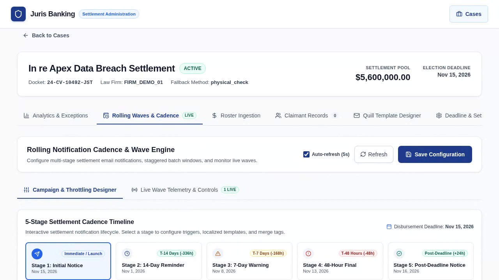
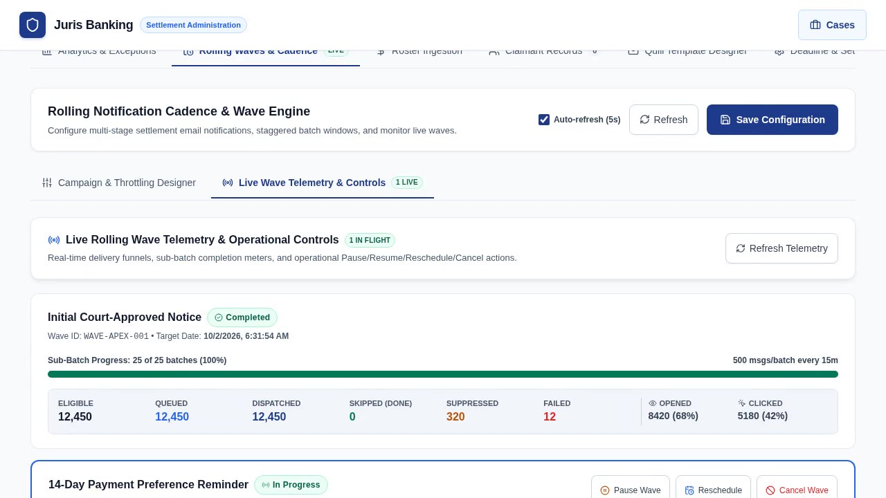
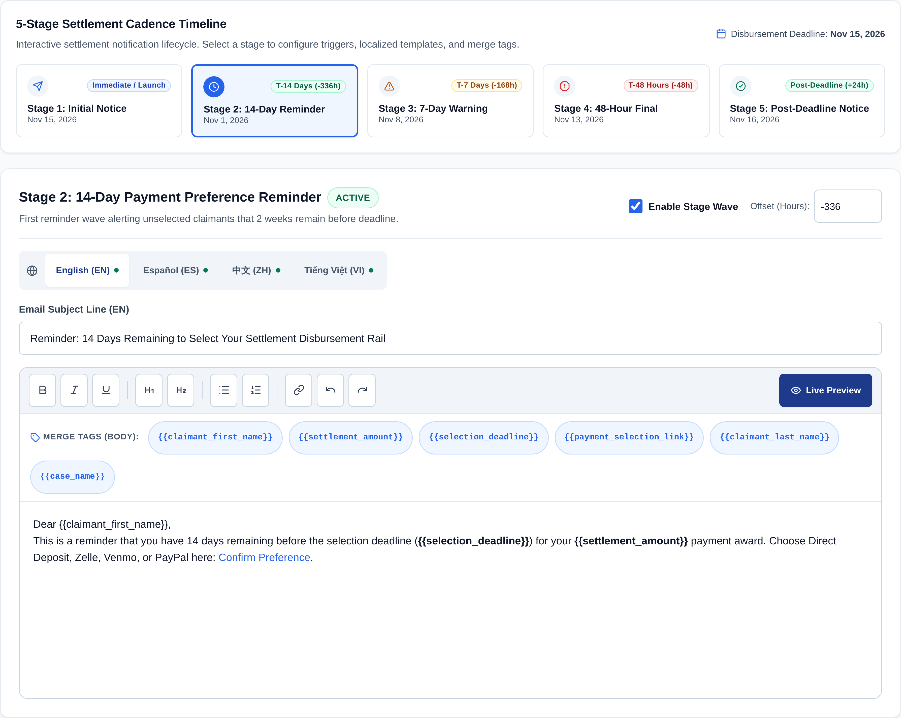
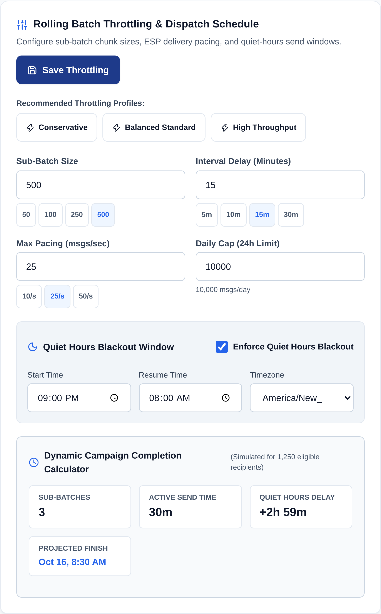
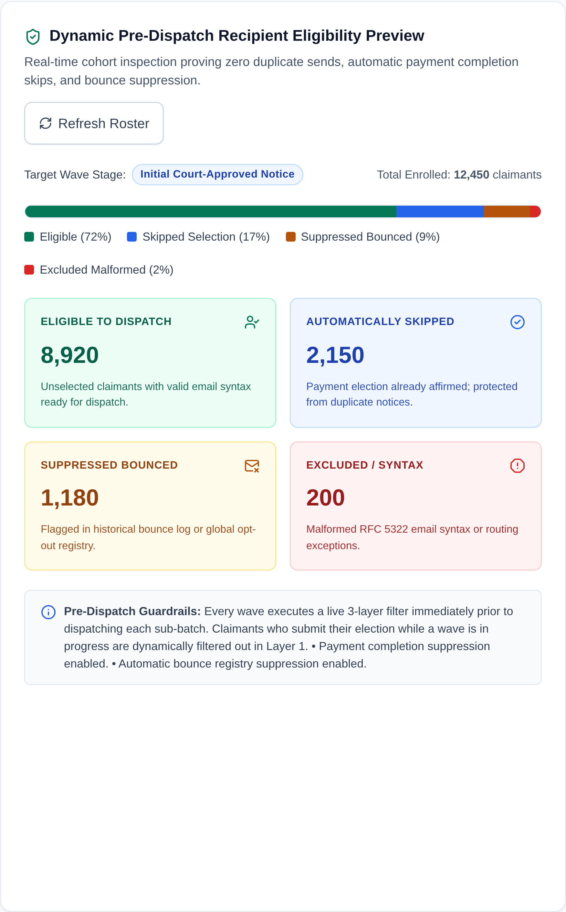
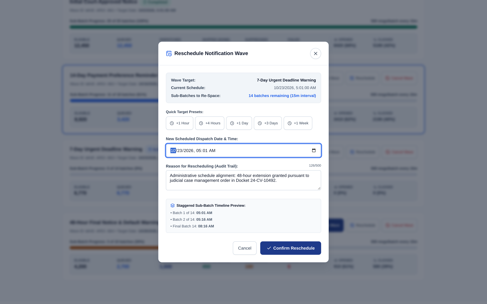

# JurisBanking Rolling Emails & Settlement Notification Scheduling: Operational UX Guide

## 1. Executive Summary & Architecture Overview

### 1.1 Enterprise Fintech & Class-Action Settlement Context
In large-scale legal class-action distributions, timely and reliable claimant communication is a core legal and fiduciary obligation. Claimants must receive timely court-approved notices, deadline reminders, and payment election magic links across multiple localized languages. 

However, mass email campaigns present severe technical and deliverability risks:
1. **ESP Rate Limiting & Spam Filtering**: Blasting 50,000+ emails simultaneously triggers automated defenses at major Mailbox Providers (Google Workspace, Microsoft 365, Yahoo/AOL), resulting in connection throttles (`421/451` temporary rejections), domain blacklisting, or silent routing to spam folders.
2. **Redundant Notification Fatigue**: In static campaigns, claimants who submit their payment preference on Day 1 frequently receive automated reminder emails on Day 14 or Day 23 because the recipient cohort was statically queued at campaign launch.
3. **Reputation Poisoning**: Retrying invalid or bounced email addresses degrades domain reputation, increasing bounce rates above the critical 2.0% threshold enforced by Google and Yahoo.

The **JurisBanking Rolling Emails & Settlement Notification Scheduling Engine** solves these challenges through:
- A deterministic **5-Stage Notification Cadence** synchronized with court-mandated disbursement deadlines.
- **Localized Quill WYSIWYG Templates** across four languages (`EN`, `ES`, `ZH`, `VI`) with dynamic claimant merge tags.
- **Staggered Rolling Batch Throttling** using sub-batch chunking, inter-batch delays, per-second rate limits, daily caps, and quiet-hours blackout windows across timezones.
- **Real-Time Pre-Dispatch Filtering & 3-Layer Suppression** that inspects each claimant's live payment status, RFC 5322 syntax, suppression registry, and historical bounce flags milliseconds before transmission.
- **Live Wave Observability & Interactive Operational Controls** (Pause, Resume, Reschedule, Cancel) in the administrative React console.

---

### 1.2 System Architecture & Data Flow

```
+---------------------------------------------------------------------------------------------------------+
|                                        JURISBANKING ARCHITECTURE                                        |
+---------------------------------------------------------------------------------------------------------+
| [Admin React UI: CaseDetail]                                                                            |
|   ├── Rolling Cadence Timeline Builder (5 stages, localized WYSIWYG templates: EN, ES, ZH, VI)          |
|   ├── Batch Throttling Designer (chunk size, interval delay, pacing, quiet hours, send windows)         |
|   ├── Eligibility & Suppression Preview (pending, skipped, suppressed counts)                          |
|   └── Live Wave Telemetry Console (funnels, progress bars, Pause / Resume / Reschedule / Cancel)        |
+---------------------------------------------------|-----------------------------------------------------+
                                                    | REST APIs (Bearer JWT, RBAC, Zod)
                                                    v
+---------------------------------------------------------------------------------------------------------+
| [Express API Gateway & Controllers]                                                                     |
|   ├── /api/cases/:caseId/cadence               (GET, PUT, POST)                                         |
|   ├── /api/cases/:caseId/cadence/preview-schedule (POST)                                                |
|   ├── /api/cases/:caseId/waves                 (GET)                                                    |
|   ├── /api/waves/:waveId/pause|resume|reschedule|cancel (POST)                                          |
|   └── /api/suppression                         (GET, POST)                                              |
+---------------------------------------------------|-----------------------------------------------------+
                                                    | CadenceService & WaveControlService
                                                    v
+---------------------------------------------------------------------------------------------------------+
| [Agenda 6.x Background Engine & Mongo Store]                                                            |
|   ├── Job: 'cadence:evaluate-stages'           (evaluates deadline offsets, triggers wave generation)   |
|   └── Job: 'wave:dispatch-subbatch'            (processes throttled chunk, quiet hours, backoff)        |
|                                                   |                                                     |
|                                                   v Just-In-Time Pre-Dispatch Filtering                 |
|                          +---------------------------------------------------------+                    |
|                          | 1. Payment status check (skip if status !== 'pending')  |                    |
|                          | 2. 3-Layer suppression: RFC 5322 + registry + bounce    |                    |
|                          | 3. Rate limiter pacing delay (e.g. 40ms = 25 msgs/sec)  |                    |
|                          +---------------------------------------------------------+                    |
|                                                   |                                                     |
|                                                   v                                                     |
|                                     [EmailService / SMTP Transport]                                     |
+---------------------------------------------------|-----------------------------------------------------+
                                                    | Mongoose 8.x Models
                                                    v
+---------------------------------------------------------------------------------------------------------+
| [MongoDB Collections]                                                                                   |
|   ├── notificationCadences (per-case cadence config, 5 stage templates EN/ES/ZH/VI, throttling)         |
|   ├── emailWaves           (wave instance, status, scheduledDate, completedDate, telemetry)             |
|   ├── subBatches           (chunked recipient cohorts, retry counts, execution logs)                    |
|   ├── suppressionLists     (bounces, opt-outs, invalid addresses)                                       |
|   └── cases / claimants    (existing core settlement records)                                           |
+---------------------------------------------------------------------------------------------------------+
```

---

## 2. Multi-Stage Settlement Cadence Lifecycle

### 2.1 The 5 Logical Notification Stages
The settlement notification lifecycle follows five deterministic stages synchronized relative to case creation and the court-mandated `disbursementDeadline`:

| Stage # | Stage Key | Title | Default Offset | Trigger Calculation | Target Audience | Core Objective |
| :---: | :--- | :--- | :---: | :--- | :--- | :--- |
| **1** | `initial_notice` | Initial Court-Approved Notice | `0h` | Immediate at campaign activation | 100% of newly ingested claimants | Deliver formal legal notice, settlement amount, and magic link |
| **2** | `reminder_14d` | 14-Day Decision Reminder | `-336h` | `disbursementDeadline - 14 days` | Unselected claimants (`status === 'pending_selection'`) | Midway engagement reminder warning of upcoming deadline |
| **3** | `urgent_warning_7d` | 7-Day Urgent Deadline Warning | `-168h` | `disbursementDeadline - 7 days` | Unselected claimants (`status === 'pending_selection'`) | Urgent alert emphasizing 1-week digital election cutoff |
| **4** | `final_notice_48h` | 48-Hour Final Notice | `-48h` | `disbursementDeadline - 48 hours` | Unselected claimants (`status === 'pending_selection'`) | Final warning that default fallback payment rail will lock in |
| **5** | `post_deadline_fallback` | Post-Deadline Fallback Notice | `+24h` | `disbursementDeadline + 24 hours` | Defaulted claimants (`status === 'pending_selection'`) | Confirmation that election closed and paper check was mailed |

---

### 2.2 Localized WYSIWYG Template Architecture
Each stage maintains independent, localized rich-text templates configured via the Quill WYSIWYG editor across four primary languages:
- **English (`EN`)**: Standard court-approved settlement text.
- **Spanish (`ES`)**: Certified Spanish legal translation for Hispanic class members.
- **Chinese (`ZH`)**: Simplified Chinese translation for Asian-American class cohorts.
- **Vietnamese (`VI`)**: Vietnamese translation serving key regional class demographics.

#### Dynamic Claimant Merge Tags
Templates dynamically interpolate recipient metadata at dispatch time:
- `{{claimant_first_name}}`: Recipient's legal first name (e.g., `Jonathan`).
- `{{claimant_last_name}}`: Recipient's legal last name (e.g., `Doe`).
- `{{settlement_amount}}`: Formatted settlement entitlement (e.g., `$450.00`).
- `{{selection_deadline}}`: Formatted deadline date (e.g., `November 30, 2026`).
- `{{payment_selection_link}}`: Secure, passwordless HTTPS magic link binding a 64-character hex token (e.g., `https://portal.juris-banking.com/claim/0123...`).
- `{{case_name}}`: Official case title and court docket number (e.g., `In re Apex Privacy Settlement`).

#### HTML Sanitization & Rendering Safety
All template markup is sanitized on the backend using `sanitize-html` to enforce strict XSS defense:
- Permitted tags: `<p>`, `<b>`, `<strong>`, `<i>`, `<em>`, `<u>`, `<h1>`, `<h2>`, `<h3>`, `<ul>`, `<ol>`, `<li>`, `<a>`, `<span>`, `<br>`, `<blockquote>`.
- Permitted attributes: `href`, `target`, `rel`, `style` (color, text-align).
- All links automatically enforce `rel="noopener noreferrer"`.

---

## 3. State Transition Model & Claimant Journey

### 3.1 State Machine Diagram

```
[Wave Lifecycle]
       +--------------+
       |    Draft     |
       +-------+------+
               | Admin activates / Cadence evaluates
               v
       +--------------+        Admin Reschedule
       |  Scheduled   |<------------------------------+
       +-------+------+                               |
               | Trigger time reached                  |
               v                                      |
       +--------------+        Admin Pause            |
+----->| In Progress  +-------------------->+---------+----+
|      +-------+------+                     |   Paused     |
|              |                            +----+---------+
|              | All sub-batches dispatched      | Admin Resume
|              v                                 v
|      +--------------+                     [In Progress]
|      |  Completed   |                          |
|      +--------------+                          | Admin Cancel
|                                                v
|      +--------------+                     +----+---------+
+------+ Rescheduled  |<--------------------+  Cancelled   |
       +--------------+  Admin Reschedule   +--------------+
                                              (Terminal)

[Sub-Batch Lifecycle]
       +--------------+
       |   Pending    |
       +-------+------+
               | Scheduled run time arrives
               v
       +--------------+        Quiet Hours Active
       | In Progress  +---------------------------------> [Deferred (Next Window)]
       +-------+------+                                           |
               |                                                  v
               | Loop through chunk recipients                [Pending]
               v
       +--------------+
       |  Completed   |
       +--------------+

[Claimant Lifecycle]
       +-----------------------+
       |   Pending Selection   |
       +-----------+-----------+
                   |
         +---------+---------+--------------------+
         |                   |                    |
         v                   v                    v
  Claimant selects    Invalid RFC 5322     Never selects rail
   payment rail       or ESP Bounce        before deadline
         |                   |                    |
         v                   v                    v
   [Selected]        [Suppressed/Bounced]   [Post-Deadline Fallback]
         |                   |                    |
         v                   v                    v
 [Queued for SFTP]    (Excluded from      (Assigned Physical Check
         |             future waves)       by Mail disbursement)
         v
    [Disbursed]
```

---

### 3.2 Claimant Journey Scenarios

#### Scenario A: Prompt Responder (Happy Path)
1. **Day 0**: Claimant receives `Initial Court-Approved Notice` containing magic link.
2. **Day 3**: Claimant clicks magic link, authenticates passwordlessly, selects **Zelle**, and provides verified mobile number.
3. **Day 3**: Claimant state transitions from `pending_selection` to `selected`.
4. **Day 16 (T-14d)**: `14-Day Decision Reminder` wave dispatches. The Pre-Dispatch filter queries the database immediately before sending, detects `status === 'selected'`, and **skips** the claimant without sending an email.
5. **Day 23 (T-7d) & Day 28 (T-48h)**: Claimant is automatically skipped across all subsequent waves.

#### Scenario B: Hesitant Responder (Midway Engagement)
1. **Day 0**: Claimant receives `Initial Court-Approved Notice` but does not open it.
2. **Day 16 (T-14d)**: Claimant receives `14-Day Decision Reminder`. Opens email but gets distracted.
3. **Day 23 (T-7d)**: Claimant receives `7-Day Urgent Deadline Warning`. Clicks magic link, selects **Direct Deposit (ACH)**, and inputs routing/account number with real-time Luhn/Mod-10 validation.
4. **Day 28 (T-48h)**: `48-Hour Final Notice` wave runs. Pre-Dispatch filter detects `status === 'selected'` and skips claimant.

#### Scenario C: Non-Responsive Claimant (Court-Mandated Fallback)
1. **Days 0–28**: Claimant ignores Stages 1, 2, 3, and 4.
2. **Day 30**: Case `disbursementDeadline` expires.
3. **Day 31 (+24h)**: `Post-Deadline Fallback Notice` wave executes. Target audience is evaluated specifically for claimants whose status remains `pending_selection`.
4. **Day 31**: Claimant receives confirmation that their election window has closed, their payment has been assigned to **Physical Check by Mail**, and the check will be dispatched to their address of record.

---

## 4. Rolling Batch Throttling & Sender Reputation Defense

### 4.1 Throttling Architecture
To prevent ESP rate limiting and protect domain reputation, large claimant rosters are partitioned into staggered sub-batches scheduled via Agenda jobs.

```
Total Roster: 10,000 Claimants
  ├── Sub-Batch 01 (Recipients 1-500)     --> Scheduled: T+00m
  ├── Sub-Batch 02 (Recipients 501-1000)  --> Scheduled: T+15m
  ├── Sub-Batch 03 (Recipients 1001-1500) --> Scheduled: T+30m
  ...
  └── Sub-Batch 20 (Recipients 9501-10000)--> Scheduled: T+285m
```

#### Key Throttling Parameters
- `batchSize`: Number of recipients allocated per sub-batch chunk (Range: 10–5,000; Recommended: 250–500).
- `intervalMinutes`: Stagger spacing between consecutive sub-batch dispatches (Range: 1–120 min; Recommended: 15 min).
- `rateLimitPerSecond`: Message dispatch pacing within an active sub-batch (Range: 1–100 msgs/sec; Recommended: 25 msgs/sec). A pacing delay `delayMs = Math.floor(1000 / rateLimitPerSecond)` is enforced between individual SMTP transmissions.
- `dailyCap`: Maximum aggregate messages allowed per 24-hour rolling window (Range: 100–100,000; Recommended: 10,000).
- `quietHoursEnabled`, `quietHoursStart`, `quietHoursEnd`, `timezone`: Local time blackout window (Default: `22:00` to `07:00` in configured timezone).

---

### 4.2 Throttling Presets

| Preset Name | Batch Size | Interval | Rate Limit | Daily Cap | Target Operational Context |
| :--- | :---: | :---: | :---: | :---: | :--- |
| **Conservative** | 100 | 15 min | 10 msgs/sec | 5,000 | Warming up new sending domains or recovering from reputation drops |
| **Balanced Standard** | 250 | 15 min | 25 msgs/sec | 10,000 | Standard production baseline for class actions under 50,000 claimants |
| **High Throughput** | 500 | 10 min | 50 msgs/sec | 25,000 | Accelerated delivery for urgent T-48h final notices with established domains |

---

### 4.3 Quiet Hours Deferral Algorithm
Dispatches falling inside quiet hours (e.g., 10:00 PM – 7:00 AM) are automatically deferred to prevent recipient disruption and maximize open rates:
1. When `wave:dispatch-subbatch` executes, it determines the current local time in the case timezone (`date.toLocaleTimeString('en-GB', { timeZone })`).
2. If the current time falls within `[quietHoursStart, quietHoursEnd]`, execution halts immediately.
3. The engine invokes `calculateNextSendWindow()`, which rolls the schedule forward to `quietHoursEnd` (07:00 AM) of the current or following day.
4. The sub-batch state is marked `deferred_quiet_hours` and rescheduled in Agenda.

---

### 4.4 Campaign Completion Simulation & Deadline Overrun Warning
The UI dynamically calculates campaign duration using:

$$\text{Total Batches} = \left\lceil \frac{\text{Total Recipients}}{\text{Batch Size}} \right\rceil$$
$$\text{Active Minutes} = (\text{Total Batches} - 1) \times \text{Interval Minutes}$$
$$\text{Total Elapsed Time} = \text{Active Minutes} + \text{Quiet Hours Delay} + \text{Daily Cap Rollovers}$$

**Deadline Overrun Guard**: If the projected completion date exceeds the case `disbursementDeadline`, the interface triggers an amber warning banner, prompting the administrator to increase batch size or shorten intervals.

---

## 5. Dynamic Pre-Dispatch Filtering & 3-Layer Suppression Engine

### 5.1 Just-In-Time Evaluation Invariant
A foundational architectural invariant of JurisBanking is **Just-In-Time Filtering**: claimant eligibility is NEVER frozen at the time a wave is configured or scheduled. Instead, filtering occurs synchronously in the dispatch worker immediately prior to sending each email.

```
[Sub-Batch Execution Loop]
For each recipient in SubBatch:
  │
  ├── 1. Query fresh Claimant record from DB
  │
  ├── 2. Pre-Dispatch Check 1: Dynamic Payment Status
  │      Is freshClaimant.status !== 'pending_selection'?
  │      --> YES: Mark 'skipped_completed', increment telemetry, do NOT send.
  │
  ├── 3. Pre-Dispatch Check 2: 3-Layer Suppression Engine
  │      ├── Layer 1: validateEmailSyntax(email) [RFC 5322 regex]
  │      │   --> FAILS: Mark 'suppressed_bounced', add to SuppressionList, do NOT send.
  │      ├── Layer 2: SuppressionList.findOne({ email, caseId })
  │      │   --> MATCH: Mark 'suppressed_bounced', do NOT send.
  │      └── Layer 3: freshClaimant.bounced === true
  │          --> MATCH: Mark 'suppressed_bounced', do NOT send.
  │
  ├── 4. Pre-Dispatch Check 3: Delivery Attempts & Cooldown
  │      deliveryAttempts >= 5 OR cooldown active?
  │      --> YES: Mark 'failed' or defer retry.
  │
  └── 5. Interpolate localized template merge tags and dispatch via SMTP!
```

---

### 5.2 3-Layer Suppression Hierarchy
1. **Layer 1: RFC 5322 Syntax Validator (`validateEmailSyntax`)**:
   - Rejects missing `@`, invalid domain structures, consecutive dots (`..`), leading/trailing periods, and addresses exceeding 254 characters.
   - Automatically marks claimant `bounced = true` with reason `RFC 5322 syntax failure` and creates an audit entry in `SuppressionList`.
2. **Layer 2: Suppression Registry (`SuppressionList`)**:
   - Queries MongoDB for matching email addresses scoped globally or per-case.
   - Blocks claimants who previously unsubscribed, filed spam complaints, or are subject to court opt-out exclusions.
3. **Layer 3: Historical Bounce Registry**:
   - Checks `Claimant.bounced` and `Claimant.bounceReason`.
   - Prevents sending to addresses that encountered hard bounces in earlier waves.

---

### 5.3 Wave Telemetry Funnel
Every wave tracks real-time counters updated atomically via MongoDB `$inc`:

| Metric Key | Label | Description |
| :--- | :--- | :--- |
| `eligible` | Total Eligible | Number of claimants originally eligible when the wave was initialized |
| `queued` | Queued in Batches | Number of claimants currently assigned to pending sub-batches |
| `dispatched` | Dispatched (Sent) | Number of emails successfully delivered via SMTP transport |
| `skipped_completed` | Skipped (Completed) | Claimants dynamically skipped because payment preference was already submitted |
| `suppressed_bounced`| Suppressed / Bounced | Claimants skipped due to syntax errors, suppression list match, or historical bounce |
| `failed` | Delivery Failed | Fatal transmission errors or exceeded retry limits |
| `opened` | Opened | Count of unique email opens tracked via tracking pixel |
| `clicked` | Link Clicked | Count of unique magic link clicks navigating to payment portal |

---

## 6. Administrative Operational Controls

### 6.1 Deterministic Wave State Controls

```
+-------------+---------------------+------------------------------------------------------------------+
| Action      | Permitted States    | Deterministic Backend Effects                                    |
+-------------+---------------------+------------------------------------------------------------------+
| Pause Wave  | in_progress,        | 1. Sets wave.status = 'paused', wave.controlState.isPaused = true |
|             | scheduled           | 2. Atomically sets all pending/queued SubBatches to 'paused'     |
|             |                     | 3. Cancels all pending 'wave:dispatch-subbatch' Agenda jobs      |
|             |                     | 4. Active sub-batch loop halts cleanly before next recipient     |
+-------------+---------------------+------------------------------------------------------------------+
| Resume Wave | paused,             | 1. Sets wave.status = 'in_progress', isPaused = false            |
|             | rescheduled         | 2. Re-queries all paused SubBatches sorted by chunkIndex         |
|             |                     | 3. Reschedules Agenda jobs spaced by intervalMinutes from now    |
|             |                     | 4. Sets SubBatch statuses back to 'pending'                      |
+-------------+---------------------+------------------------------------------------------------------+
| Reschedule  | scheduled, paused,  | 1. Validates newDate > Date.now()                                |
| Wave        | in_progress         | 2. Sets wave.status = 'rescheduled', scheduledDate = newDate     |
|             |                     | 3. Cancels existing Agenda jobs                                  |
|             |                     | 4. Re-spaces pending SubBatches starting at newDate              |
+-------------+---------------------+------------------------------------------------------------------+
| Cancel Wave | scheduled, paused,  | 1. Sets wave.status = 'cancelled' (Terminal State)               |
|             | in_progress,        | 2. Sets all pending SubBatches to 'cancelled'                    |
|             | rescheduled         | 3. Permanently cancels all pending Agenda jobs                   |
+-------------+---------------------+------------------------------------------------------------------+
```

---

### 6.2 WCAG 2.1 AA Accessible Control Modals
All operational actions (Pause, Resume, Reschedule, Cancel) are governed by accessible confirmation modals:
- **ARIA Compliance**: Implements `role="dialog"`, `aria-modal="true"`, and `aria-labelledby`.
- **Keyboard Trapping**: Traps `Tab` and `Shift+Tab` cycles strictly inside the dialog container; dismissible via `Escape`.
- **Touch Target Assurance**: All interactive buttons strictly meet minimum 44×44px touch targets.

---

## 7. Visual Walkthrough & UI Reference

### 7.0 HD Interactive Video Tutorials (Flows 5 & 6)
In addition to the high-resolution Retina screenshots below, two **1280×720 HD H.264 MP4 tutorial walkthroughs** demonstrate the end-to-end operational workflow for configuring multi-stage notification cadences, tuning sub-batch throttling parameters, and operating live wave controls:

| Flow | Walkthrough Title | Duration | Video Asset | Poster Snapshot |
| :---: | :--- | :---: | :--- | :--- |
| **Flow 5** | **Multi-Stage Cadence Builder & Batch Throttling Designer** | `00:16` (`729 KB`) | [`videos/05_rolling_cadence_and_throttling_designer.mp4`](videos/05_rolling_cadence_and_throttling_designer.mp4) |  |
| **Flow 6** | **Live Rolling Wave Telemetry Funnel & Operational Controls** | `00:31` (`1.27 MB`) | [`videos/06_live_wave_telemetry_and_controls.mp4`](videos/06_live_wave_telemetry_and_controls.mp4) |  |

<video src="videos/05_rolling_cadence_and_throttling_designer.mp4" poster="videos/posters/05_rolling_cadence_and_throttling_designer.jpg" controls preload="metadata" width="100%"></video>

<video src="videos/06_live_wave_telemetry_and_controls.mp4" poster="videos/posters/06_live_wave_telemetry_and_controls.jpg" controls preload="metadata" width="100%"></video>

For complete step-by-step training procedures across all six platform walkthroughs, see [`docs/TRAINING_VIDEOS.md`](TRAINING_VIDEOS.md).

---

### 7.1 Cadence Timeline & Stage Builder
The **Rolling Cadence Timeline Builder** enables administrators to visualize the 5-stage settlement notification cadence, configure offset hours relative to the disbursement deadline, and compose rich-text notices across four localized languages.



#### Functional Elements:
1. **Interactive Timeline Bar**: Visual sequence displaying all five stages (`Initial Notice`, `14-Day Reminder`, `7-Day Warning`, `48-Hour Final`, and `Post-Deadline Notice`) with relative offset badges (`Launch`, `T-14 Days`, `T-7 Days`, `T-48 Hours`, `Post-Deadline`). Clicking any node loads its configuration.
2. **Stage Enablement Toggle**: Switch permitting administrators to enable or bypass specific stages according to court orders.
3. **Offset Hours Input**: Numerical offset in hours relative to the disbursement deadline (e.g., `-336` for T-14d, `+24` for post-deadline).
4. **Localized Language Tabs**: Roving-tabindex tabs switching between `English (EN)`, `Español (ES)`, `中文 (ZH)`, and `Tiếng Việt (VI)`.
5. **Dynamic Merge Tag Pills**: Clickable tag pills (`{{claimant_first_name}}`, `{{settlement_amount}}`, `{{selection_deadline}}`, `{{payment_selection_link}}`, `{{case_name}}`) that copy placeholders directly to clipboard for effortless insertion.
6. **Quill WYSIWYG Editor**: Accessible rich-text authoring surface with formatting controls (Bold, Italic, Headings, Ordered/Unordered Lists, Links).

---

### 7.2 Batch Throttling Settings Card
The **Batch Throttling Settings Card** provides fine-grained controls to pace campaign delivery, safeguard ESP reputation, and simulate estimated completion timelines before triggering live sends.



#### Functional Elements:
1. **Pacing Presets**: One-click configuration cards for `Conservative` (100 msgs / 15m), `Balanced Standard` (250 msgs / 15m), and `High Throughput` (500 msgs / 10m).
2. **Sub-Batch Chunk Slider**: Slider controlling recipient chunk size per dispatch (10 to 5,000 recipients).
3. **Inter-Batch Delay Slider**: Slider setting wait intervals between consecutive sub-batches (1 to 120 minutes).
4. **Quiet Hours Blackout Window**: Toggles night-time quiet hours (`22:00` to `07:00`) and selects the target timezone (e.g., `America/New_York`, `America/Chicago`, `America/Los_Angeles`).
5. **Live Campaign Forecast Panel**: Real-time simulation displaying total sub-batches, active duration, quiet hours delays, projected completion date, and an amber warning alert if completion risks overrunning the court-ordered deadline.

---

### 7.3 Recipient Eligibility & Suppression Preview Card
The **Recipient Eligibility & Suppression Preview Card** provides real-time visibility into the claimant roster composition before dispatching a notification wave.



#### Functional Elements:
1. **Proportional Status Bar**: Multi-segment visual bar illustrating the proportional breakdown of the roster:
   - **Eligible Pending (Emerald/Green)**: Claimants in `pending_selection` status who will receive the email.
   - **Skipped Completed (Blue/Indigo)**: Claimants who already submitted payment preferences and will be skipped.
   - **Suppressed Bounced (Amber)**: Claimants excluded due to historical bounces or suppression list matches.
   - **Excluded Syntax (Rose)**: Claimants excluded due to malformed RFC 5322 email syntax.
2. **Metric Summary Counters**: High-contrast tabular numerical display of enrolled claimants, eligible recipients, and suppression categories.
3. **Live Roster Re-sync Button**: Refreshes counts directly from the database to reflect recent claimant portal submissions.

---

### 7.4 Live Rolling Wave Telemetry Console & Controls
The **Live Rolling Wave Telemetry Console** provides platform operators and case managers with real-time operational visibility and one-click controls over in-flight, scheduled, and completed notification waves.



#### Functional Elements:
1. **Wave Card Registry**: Cards sorted chronologically by scheduled date displaying stage name, status badge (`In Progress`, `Paused`, `Scheduled`, `Rescheduled`, `Completed`, `Cancelled`), and throttling parameters.
2. **Sub-Batch Progress Bar**: High-precision progress bar displaying completed vs. total sub-batches and percentage progress (`completed of total batches (X%)`).
3. **Live Telemetry Funnel**: Real-time counter grid detailing `Eligible`, `Queued`, `Dispatched`, `Skipped (Done)`, `Suppressed`, and `Failed`.
4. **Operational Action Toolbar**:
   - **Pause Wave**: Halts in-progress or scheduled wave, canceling pending Agenda sub-batch jobs.
   - **Resume Wave**: Resumes paused wave, recalculating future intervals for remaining batches.
   - **Reschedule Wave**: Opens date picker modal to defer wave to a future date.
   - **Cancel Wave**: Permanently aborts pending sub-batches with confirmation prompt.
5. **Accessible Action Modals**: Modal dialogues requiring reason input and confirmation to prevent accidental disruptions.

---

## 8. Verification & Operational Best Practices

1. **Pre-Campaign Checklist**:
   - Verify that all localized templates (`EN`, `ES`, `ZH`, `VI`) are populated and previewed.
   - Check that the `disbursementDeadline` on the Case record is at least 30 days in the future.
   - Ensure the projected completion date in the Throttling Designer precedes the deadline.
2. **During Live Waves**:
   - Monitor the `Skipped (Completed)` counter in the Live Wave Console. A steadily rising count indicates successful claimant portal conversions.
   - If ESP error rates (`Failed`) exceed 1.0%, click **Pause Wave**, inspect the error logs in `SubBatch.executionLogs`, and adjust rate limits or batch sizes before resuming.
3. **Post-Campaign Audit**:
   - Export wave telemetry to CSV/PDF for inclusion in court compliance declarations and final settlement distribution affidavits.
